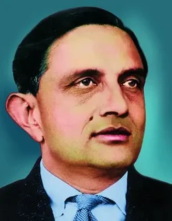

# 维克拉姆·萨拉巴伊

**英文名：** Vikram Sarabhai

**生卒：** 1919年8月12日 — 1971年12月30日

**主要领域：** 宇宙线、空间物理

肖像的作者、拍摄或创作年代及具体形式见图片来源。

## 生平简介

印度物理学家，曾在剑桥大学学习，回国后创建艾哈迈达巴德物理研究实验室。他从宇宙线实验发展到空间科学和卫星应用，是印度早期空间研究计划的主要组织者。

## 对物理的主要贡献

- 研究热带宇宙线强度变化及其与地磁环境的关系
- 创建宇宙线与空间物理研究平台
- 组织印度早期空间科学和卫星应用研究

## 肖像来源与许可

- 来源：[Dr_Vikram_Sarabhai_ISRO.webp](https://commons.wikimedia.org/wiki/File:Dr_Vikram_Sarabhai_ISRO.webp)
- 作者／署名：Indian Space Research Organisation (ISRO)
- 许可：[GODL-India](https://data.gov.in/sites/default/files/Gazette_Notification_OGDL.pdf)
- 本地文件：[0335330bd8b72902f053.webp](../portraits/0335330bd8b72902f053.webp)
- 原始来源说明：The respective image has been obtained from the official website of Indian Space Research Organisation. https://www.isro.gov.in/sarabhaiformer.html According to ISRO's Copyright Policy, materials on the site are owned by the Department of Space (DOS)/ISRO and may be reproduced free of charge in any format or media without requiring specific permission. This reproduction is permitted under the condition that the material is reproduced accurately and not used in a derogatory manner or in a misleading context. Additionally, the source must be prominently acknowledged whenever the material is published or issued to others. However, this permission does not extend to materials explicitly identified as the copyright of a third party; authorization to reproduce such materials must be obtained from the respective copyright holders. You can read about their copyright policy below 👇. https://www.isro.gov.in/Copyright_Policy.html

## 资料来源

- [Wikipedia: Vikram Sarabhai](https://en.wikipedia.org/wiki/Vikram_Sarabhai)

资料整理日期：2026-10-26。
