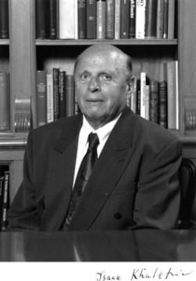

# 伊萨克·哈拉特尼科夫

**英文名：** Isaak Khalatnikov

**生卒：** 1919年10月17日 — 2021年1月9日

**主要领域：** 低温物理、广义相对论

已核对对应人物条目使用的历史肖像；图像文件来自英语维基百科本地文件库。

## 生平简介

苏联及俄罗斯理论物理学家，早年与朗道合作，曾任朗道理论物理研究所所长。他研究超流体、量子液体和宇宙学，将多体理论方法拓展到相对论动力学问题。

## 对物理的主要贡献

- 发展超流氦的朗道—哈拉特尼科夫动力学理论
- 与别林斯基、利夫希茨研究宇宙学奇点附近的BKL行为
- 研究量子液体及相对论流体

## 肖像来源与许可

- 来源：[Isaak_Khalatnikov.gif](https://en.wikipedia.org/wiki/File:Isaak_Khalatnikov.gif)
- 作者／署名：见原图页面
- 许可：非自由历史照片或版权状态未确认；公开网页使用前需核查授权
- 本地文件：[5f7c1acc7a418014d072-bb6ee81dcf.gif](../portraits/5f7c1acc7a418014d072-bb6ee81dcf.gif)
- 授权状态：仅记录来源与本地档案副本；未确认可用于网站再发布，发布前须向权利人核实授权。

## 资料来源

- [Wikipedia: Isaak Khalatnikov](https://en.wikipedia.org/wiki/Isaak_Khalatnikov)

资料整理日期：2026-10-26。
