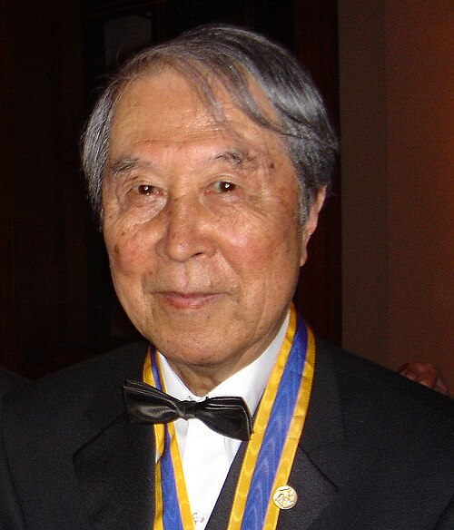

# 南部阳一郎

**英文名：** Yoichiro Nambu

**生卒：** 1921年1月18日 — 2015年7月5日

**主要领域：** 粒子物理、对称性破缺

肖像的作者、拍摄或创作年代及具体形式见图片来源。

## 生平简介

南部阳一郎出生于Tokyo, Japan，主要从事粒子物理、对称性破缺研究。诺贝尔奖资料所列获奖时任职机构为Enrico Fermi Institute, University of Chicago。其代表成果包括把自发对称性破缺概念系统引入基本粒子理论，获2008年诺贝尔物理学奖。

## 对物理的主要贡献

- 把自发对称性破缺概念系统引入基本粒子理论
- 为理解强相互作用中的低能现象提供重要思想

**诺贝尔物理学奖：** 2008

## 肖像来源与许可

- 来源：[YoichiroNambu.jpg](https://commons.wikimedia.org/wiki/File:YoichiroNambu.jpg)
- 作者／署名：Betsy Devine
- 许可：[CC BY-SA 3.0](https://creativecommons.org/licenses/by-sa/3.0)
- 本地文件：[3a5863ef989ac4cfb39c.jpg](../portraits/3a5863ef989ac4cfb39c.jpg)
- 原始来源说明：Own work

## 资料来源

- [Yoichiro Nambu - Facts](https://www.nobelprize.org/prizes/physics/2008/nambu/facts/)
- [Nobel Prize official laureate API, id 826](https://api.nobelprize.org/2.1/laureate/826)
- [Wikipedia: Yoichiro Nambu](https://en.wikipedia.org/wiki/Yoichiro_Nambu)

资料整理日期：2026-10-26。
