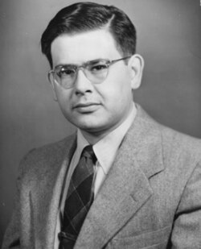

# 拉尔夫·阿尔弗

**英文名：** Ralph Alpher

**生卒：** 1921年2月3日 — 2007年8月12日

**主要领域：** 宇宙学、核天体物理

肖像的作者、拍摄或创作年代及具体形式见图片来源。

## 生平简介

美国理论物理学家，博士期间与伽莫夫研究早期宇宙核反应，后在应用研究机构及大学工作。他与赫尔曼对热宇宙残余辐射的预言是现代宇宙学的重要先声。

## 对物理的主要贡献

- 研究早期宇宙中的轻元素核合成
- 与赫尔曼预言热大爆炸遗留的背景辐射
- 研究宇宙热历史与元素丰度

## 肖像来源与许可

- 来源：[Ralph_Alpher_(cropped).jpg](https://commons.wikimedia.org/wiki/File:Ralph_Alpher_(cropped).jpg)
- 作者／署名：Credit: Alpher Papers.
- 许可：[CC BY-SA 4.0](https://creativecommons.org/licenses/by-sa/4.0)
- 本地文件：[93bf377617d3aa63ed30-cef14ebec9.jpg](../portraits/93bf377617d3aa63ed30-cef14ebec9.jpg)
- 原始来源说明：https://link.springer.com/article/10.1007/s00016-012-0088-7

## 资料来源

- [Ralph Alpher — Wikipedia reference biography](https://en.wikipedia.org/wiki/Ralph_Alpher)

资料整理日期：2026-10-26。
