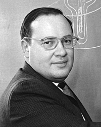

# 阿瑟·肖洛

**英文名：** Arthur Leonard Schawlow

**生卒：** 1921年5月5日 — 1999年4月28日

**主要领域：** 激光物理、精密光谱

肖像的作者、拍摄或创作年代及具体形式见图片来源。

## 生平简介

阿瑟·肖洛出生于Mount Vernon, NY, USA，主要从事激光物理、精密光谱研究。诺贝尔奖资料所列获奖时任职机构为Stanford University。其代表成果包括发展激光光谱学及窄谱线精密测量方法，获1981年诺贝尔物理学奖。

## 对物理的主要贡献

- 发展激光光谱学及窄谱线精密测量方法
- 与汤斯提出光学激射器的重要理论方案

**诺贝尔物理学奖：** 1981

## 肖像来源与许可

- 来源：[Artur_Schawlow,_Stanford_University.jpg](https://commons.wikimedia.org/wiki/File:Artur_Schawlow,_Stanford_University.jpg)
- 作者／署名：Jose Mercado / Stanford News Service
- 许可：[CC BY 3.0](https://creativecommons.org/licenses/by/3.0)
- 本地文件：[ebba1232eed91c4a34d4.jpg](../portraits/ebba1232eed91c4a34d4.jpg)
- 原始来源说明：Stanford News Service

## 资料来源

- [Arthur L. Schawlow - Facts](https://www.nobelprize.org/prizes/physics/1981/schawlow/facts/)
- [Nobel Prize official laureate API, id 119](https://api.nobelprize.org/2.1/laureate/119)
- [Wikipedia: Arthur Leonard Schawlow](https://en.wikipedia.org/wiki/Arthur_Leonard_Schawlow)

资料整理日期：2026-10-26。
