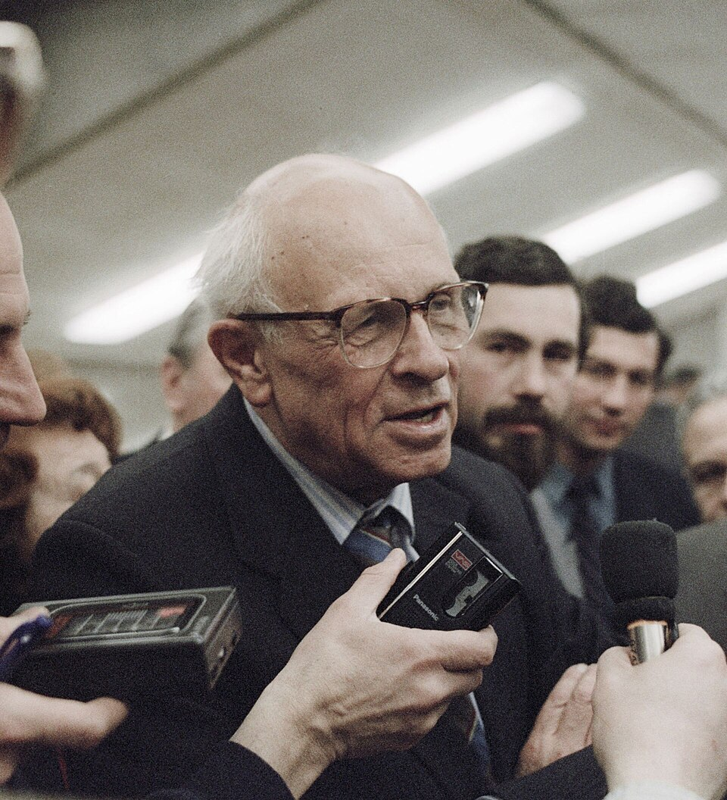

# 安德烈·萨哈罗夫

**英文名：** Andrei Sakharov

**生卒：** 1921年5月21日 — 1989年12月14日

**主要领域：** 粒子物理、宇宙学

肖像的作者、拍摄或创作年代及具体形式见图片来源。

## 生平简介

苏联理论物理学家，参与热核武器理论研究，后积极倡导人权与核裁军，获1975年诺贝尔和平奖。他在宇宙学中提出解释物质与反物质不对称所需的基本条件。

## 对物理的主要贡献

- 提出宇宙产生重子不对称的萨哈罗夫条件
- 研究诱导引力及基本相互作用
- 参与苏联早期热核武器和磁约束聚变理论

## 肖像来源与许可

- 来源：[RIAN_archive_25981_Academician_Sakharov.jpg](https://commons.wikimedia.org/wiki/File:RIAN_archive_25981_Academician_Sakharov.jpg)
- 作者／署名：Vladimir Fedorenko / Владимир Федоренко
- 许可：[CC BY-SA 3.0](https://commons.wikimedia.org/wiki/Commons:Valued_images)
- 本地文件：[1ca359b7ad9dc0eae2da.jpg](../portraits/1ca359b7ad9dc0eae2da.jpg)
- 原始来源说明：RIA Novosti archive, image #25981, http://visualrian.ru/ru/site/gallery/#25981 Digital / Цифра

## 资料来源

- [Wikipedia: Andrei Sakharov](https://en.wikipedia.org/wiki/Andrei_Sakharov)

资料整理日期：2026-10-26。
