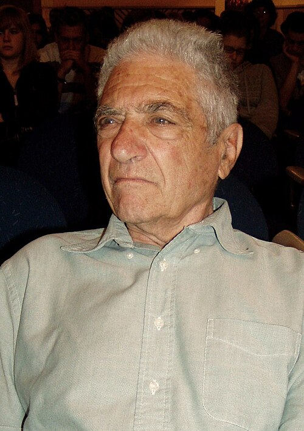

# 杰克·施泰因贝格尔

**英文名：** Jack Steinberger

**生卒：** 1921年5月25日 — 2020年12月12日

**主要领域：** 粒子物理、中微子

肖像的作者、拍摄或创作年代及具体形式见图片来源。

## 生平简介

杰克·施泰因贝格尔出生于Bad Kissingen, Germany，主要从事粒子物理、中微子研究。诺贝尔奖资料所列获奖时任职机构为CERN。其代表成果包括使用高能中微子束发现μ中微子，获1988年诺贝尔物理学奖。

## 对物理的主要贡献

- 使用高能中微子束发现μ中微子
- 证实电子中微子与μ中微子是不同类型的中微子

**诺贝尔物理学奖：** 1988

## 肖像来源与许可

- 来源：[Jack-Steinberger-2008.JPG](https://commons.wikimedia.org/wiki/File:Jack-Steinberger-2008.JPG)
- 作者／署名：Sigismund von Dobschütz
- 许可：[CC BY-SA 3.0](https://creativecommons.org/licenses/by-sa/3.0)
- 本地文件：[1601d3811d9355863894.jpg](../portraits/1601d3811d9355863894.jpg)
- 原始来源说明：Own work

## 资料来源

- [Jack Steinberger - Facts](https://www.nobelprize.org/prizes/physics/1988/steinberger/facts/)
- [Nobel Prize official laureate API, id 134](https://api.nobelprize.org/2.1/laureate/134)
- [Wikipedia: Jack Steinberger](https://en.wikipedia.org/wiki/Jack_Steinberger)

资料整理日期：2026-10-26。
