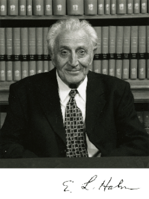

# 欧文·哈恩

**英文名：** Erwin Hahn

**生卒：** 1921年6月9日 — 2016年9月20日

**主要领域：** 核磁共振、量子相干、实验物理

肖像的作者、拍摄或创作年代及具体形式见图片来源。

## 生平简介

美国实验物理学家，在伊利诺伊大学研究核磁共振，后来长期在加州大学伯克利分校任教。他发现自旋回波并发展脉冲磁共振实验，使自旋体系的相干与弛豫可以被精细研究，其方法成为磁共振成像的重要基础。

## 对物理的主要贡献

- 发现自旋回波，揭示表观退相干中可通过操控恢复的相干信息
- 发展脉冲核磁共振和自由感应衰减测量
- 为磁共振谱学及后来的磁共振成像提供关键实验方法

## 肖像来源与许可

- 来源：[final-nuclear-erwin-hahn.gif](https://en.wikipedia.org/wiki/File:Erwin_Hahn.gif)
- 作者／署名：见原图页面
- 许可：Non-free historical photograph hosted by English Wikipedia under its fair-use rationale; that rationale does not grant a reusable image licence. Permission must be confirmed before website publication.
- 本地文件：[0737c119af7169d15459-1922e66c31.gif](../portraits/0737c119af7169d15459-1922e66c31.gif)
- 原始来源说明：Portrait reproduced in the Royal Society biographical memoir and on English Wikipedia; photographer unknown
- 授权状态：仅记录来源与本地档案副本；未确认可用于网站再发布，发布前须向权利人核实授权。

## 资料来源

- [University of California, Berkeley: Remembering Erwin Hahn](https://hwni.berkeley.edu/news/remembering-erwin-hahn-1921-2016)
- [Erwin L. Hahn Institute for MRI: Erwin Hahn](https://hahn-institute.de/de/ueber/erwin-l-hahn)
- [Wikipedia: Erwin Hahn](https://en.wikipedia.org/wiki/Erwin_Hahn)

资料整理日期：2026-10-26。
