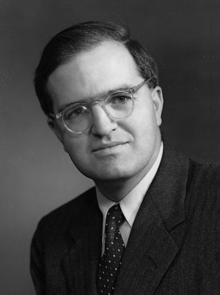

# 奥格·玻尔

**英文名：** Aage Niels Bohr

**生卒：** 1922年6月19日 — 2009年9月8日

**主要领域：** 核物理、核结构

肖像的作者、拍摄或创作年代及具体形式见图片来源。

## 生平简介

奥格·玻尔出生于Copenhagen, Denmark，主要从事核物理、核结构研究。诺贝尔奖资料所列获奖时任职机构为Niels Bohr Institute。其代表成果包括揭示原子核集体运动与单粒子运动之间的联系，获1975年诺贝尔物理学奖。

## 对物理的主要贡献

- 揭示原子核集体运动与单粒子运动之间的联系
- 发展描述变形原子核结构的理论

**诺贝尔物理学奖：** 1975

## 肖像来源与许可

- 来源：[Aage_Bohr.jpg](https://commons.wikimedia.org/wiki/File:Aage_Bohr.jpg)
- 作者／署名：Royal Danish Academy of Sciences
- 许可：Public domain
- 本地文件：[d221e80fa524f33ea1b1.jpg](../portraits/d221e80fa524f33ea1b1.jpg)
- 原始来源说明：http://www.denstoredanske.dk/@api/deki/files/2931/=294691.501.jpg?size=webview

## 资料来源

- [Aage N. Bohr - Facts](https://www.nobelprize.org/prizes/physics/1975/bohr/facts/)
- [Nobel Prize official laureate API, id 102](https://api.nobelprize.org/2.1/laureate/102)
- [Wikipedia: Aage Bohr](https://en.wikipedia.org/wiki/Aage_Bohr)

资料整理日期：2026-10-26。
