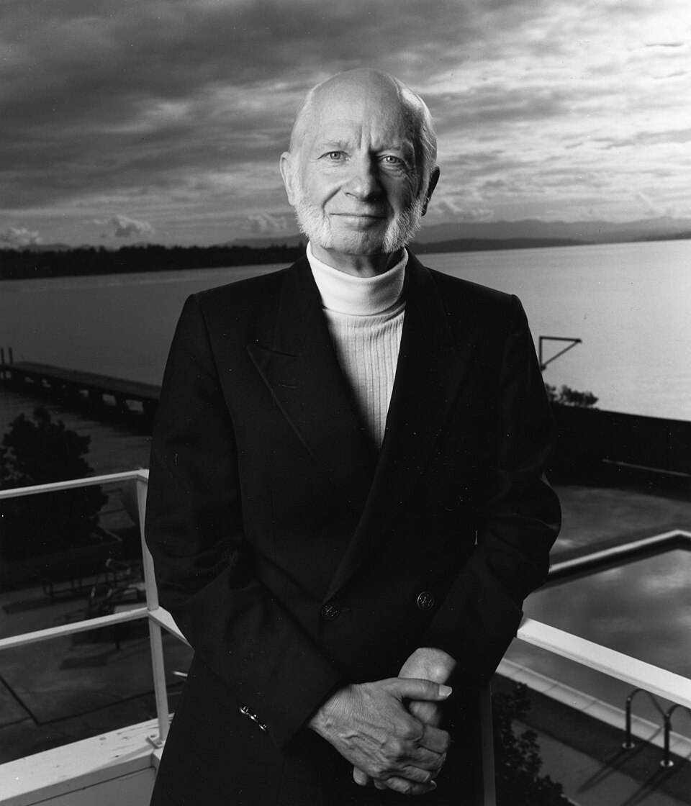

# 汉斯·德默尔特

**英文名：** Hans G. Dehmelt

**生卒：** 1922年9月9日 — 2017年3月7日

**主要领域：** 原子物理、粒子囚禁

肖像的作者、拍摄或创作年代及具体形式见图片来源。

## 生平简介

汉斯·德默尔特出生于Görlitz, Prussia (now Germany)，主要从事原子物理、粒子囚禁研究。诺贝尔奖资料所列获奖时任职机构为University of Washington。其代表成果包括发展以电磁场囚禁带电粒子的实验技术，获1989年诺贝尔物理学奖。

## 对物理的主要贡献

- 发展以电磁场囚禁带电粒子的实验技术
- 对单电子等体系的精密测量作出贡献

**诺贝尔物理学奖：** 1989

## 肖像来源与许可

- 来源：[Hans Dehmelt.jpg](https://commons.wikimedia.org/wiki/File:Hans_Dehmelt.jpg)
- 作者／署名：Photograph by Davis Freeman, University of Washington, courtesy AIP Emilio Segrè Visual Archives, W. F. Meggers Gallery of Nobel Laureates Collection, Dehmelt Collection
- 许可：Attribution
- 本地文件：[c410dc0abf16d0e3c733.jpg](../portraits/c410dc0abf16d0e3c733.jpg)
- 原始来源说明：https://repository.aip.org/hans-dehmelt

## 资料来源

- [Hans G. Dehmelt - Facts](https://www.nobelprize.org/prizes/physics/1989/dehmelt/facts/)
- [Nobel Prize official laureate API, id 136](https://api.nobelprize.org/2.1/laureate/136)
- [Wikipedia: Hans Georg Dehmelt](https://en.wikipedia.org/wiki/Hans_Georg_Dehmelt)

资料整理日期：2026-10-26。
