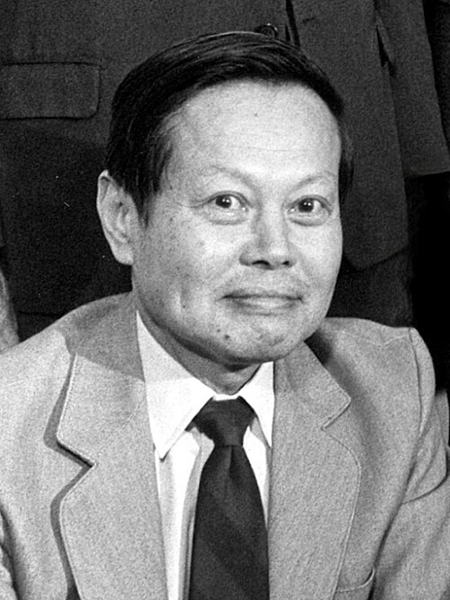

# 杨振宁

**英文名：** Chen Ning Yang

**生卒：** 1922年10月1日 — 2025年10月18日

**主要领域：** 粒子物理、规范场论、统计物理

肖像的作者、拍摄或创作年代及具体形式见图片来源。

## 生平简介

杨振宁出生于Hofei, Anhwei, China，主要从事粒子物理、规范场论、统计物理研究。诺贝尔奖资料所列获奖时任职机构为Institute for Advanced Study。其代表成果包括与李政道提出弱相互作用中宇称守恒的检验问题，获1957年诺贝尔物理学奖。

## 对物理的主要贡献

- 与李政道提出弱相互作用中宇称守恒的检验问题
- 与米尔斯建立非阿贝尔规范场论，并在统计物理中作出重要贡献

**诺贝尔物理学奖：** 1957

## 史料说明

- 出生日期存在两种正式记载：清华大学2025年生平公告作1922年10月1日，诺贝尔资料及其1963年入籍申请书作9月22日。本库采用清华大学最新生平公告的10月1日，并明确保留9月22日这一历史记录；未擅自将差异解释为历法换算。

## 肖像来源与许可

- 来源：[HD.3F.010_(11086446676)(Chen_Ning_Yang).jpg](https://commons.wikimedia.org/wiki/File:HD.3F.010_(11086446676)(Chen_Ning_Yang).jpg)
- 作者／署名：ENERGY.GOV
- 许可：Public domain
- 本地文件：[ff9bd59020f0d8186195.jpg](../portraits/ff9bd59020f0d8186195.jpg)
- 原始来源说明：HD.3F.010

## 资料来源

- [Chen Ning Yang - Facts](https://www.nobelprize.org/prizes/physics/1957/yang/facts/)
- [Nobel Prize official laureate API, id 68](https://api.nobelprize.org/2.1/laureate/68)
- [Wikipedia: Chen Ning Yang](https://en.wikipedia.org/wiki/Chen_Ning_Yang)
- [Tsinghua University: Biographical account of Chen Ning Yang (2025)](https://www.tsinghua.edu.cn/info/1173/121842.htm)
- [Tsinghua University History Museum: Yang's first US journey and nationality records](https://xsg.tsinghua.edu.cn/info/1004/3407.htm)

资料整理日期：2026-10-26。
