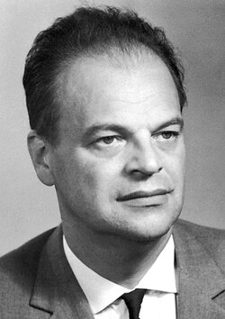

# 尼古拉·巴索夫

**英文名：** Nicolay Gennadiyevich Basov

**生卒：** 1922年12月14日 — 2001年7月1日

**主要领域：** 量子电子学、激光

肖像的作者、拍摄或创作年代及具体形式见图片来源。

## 生平简介

尼古拉·巴索夫出生于Usman, USSR (now Russia)，主要从事量子电子学、激光研究。诺贝尔奖资料所列获奖时任职机构为P.N. Lebedev Physical Institute。其代表成果包括发展基于受激辐射的微波放大与振荡原理，获1964年诺贝尔物理学奖。

## 对物理的主要贡献

- 发展基于受激辐射的微波放大与振荡原理
- 奠定微波激射器和激光技术的重要理论与实验基础

**诺贝尔物理学奖：** 1964

## 肖像来源与许可

- 来源：[Basov.jpg](https://commons.wikimedia.org/wiki/File:Basov.jpg)
- 作者／署名：Nobel foundation
- 许可：Public domain
- 本地文件：[2e9b5cc3abe9a71ff9ab.jpg](../portraits/2e9b5cc3abe9a71ff9ab.jpg)
- 原始来源说明：http://nobelprize.org/nobel_prizes/physics/laureates/1964/basov-bio.html

## 资料来源

- [Nicolay G. Basov - Facts](https://www.nobelprize.org/prizes/physics/1964/basov/facts/)
- [Nobel Prize official laureate API, id 82](https://api.nobelprize.org/2.1/laureate/82)
- [Wikipedia: Nikolay Basov](https://en.wikipedia.org/wiki/Nikolay_Basov)

资料整理日期：2026-10-26。
