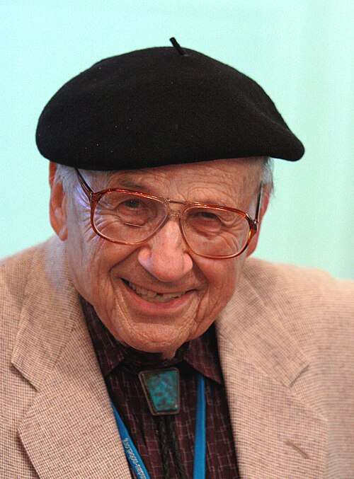

# 沃尔特·科恩

**英文名：** Walter Kohn

**生卒：** 1923年3月9日 — 2016年4月19日

**主要领域：** 凝聚态理论、密度泛函理论、电子结构

肖像的作者、拍摄或创作年代及具体形式见图片来源。

## 生平简介

奥地利出生的美国理论物理学家，少年时逃离纳粹迫害，在加拿大和美国接受教育，后在加州大学圣迭戈与圣巴巴拉分校工作。他是密度泛函理论的主要奠基者，曾主持理论物理研究所，1998年获诺贝尔化学奖。

## 对物理的主要贡献

- 与霍恩伯格建立基态密度泛函理论的重要定理
- 与沈吕九建立科恩—沈方程，为电子结构计算提供自洽框架
- 在半导体、金属电子结构和表面物理等领域作出重要贡献

## 肖像来源与许可

- 来源：[Walter_Kohn.jpg](https://commons.wikimedia.org/wiki/File:Walter_Kohn.jpg)
- 作者／署名：Markus Pössel (User name: Mapos)
- 许可：[CC BY-SA 3.0](https://creativecommons.org/licenses/by-sa/3.0)
- 本地文件：[300d5cefc18079d9b649-d5579da321.jpg](../portraits/300d5cefc18079d9b649-d5579da321.jpg)
- 原始来源说明：Own work

## 资料来源

- [UC Santa Barbara: Walter Kohn](https://www.ucsb.edu/about/faculty-and-alumni/walter-kohn-1923-2016)
- [National Academy of Sciences: Walter Kohn memorial](https://www.nasonline.org/wp-content/uploads/2024/06/kohn-walter.pdf)
- [UC Santa Barbara: Walter Kohn papers](https://archives.library.ucsb.edu/repositories/2/resources/4397)
- [Wikipedia: Walter Kohn](https://en.wikipedia.org/wiki/Walter_Kohn)

资料整理日期：2026-10-26。
