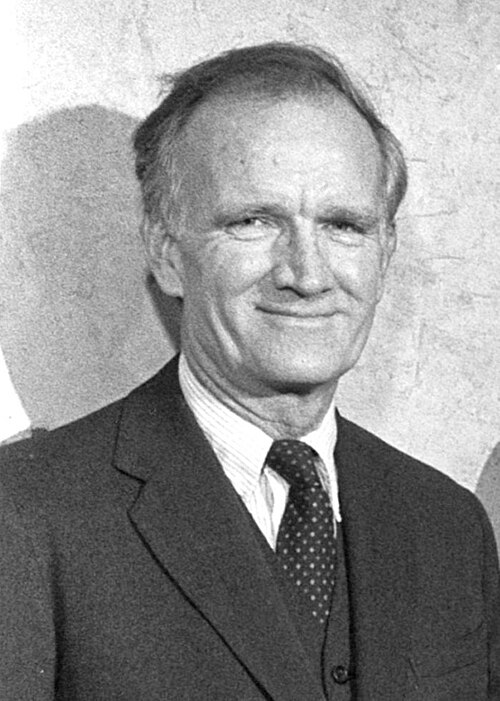

# 瓦尔·菲奇

**英文名：** Val Logsdon Fitch

**生卒：** 1923年3月10日 — 2015年2月5日

**主要领域：** 粒子物理、CP对称性

肖像的作者、拍摄或创作年代及具体形式见图片来源。

## 生平简介

瓦尔·菲奇出生于Merriman, NE, USA，主要从事粒子物理、CP对称性研究。诺贝尔奖资料所列获奖时任职机构为Princeton University。其代表成果包括发现中性K介子衰变中的CP对称性破坏，获1980年诺贝尔物理学奖。

## 对物理的主要贡献

- 发现中性K介子衰变中的CP对称性破坏
- 表明自然界部分过程不保持电荷共轭与空间反演的联合对称

**诺贝尔物理学奖：** 1980

## 肖像来源与许可

- 来源：[Val_Fitch.jpg](https://commons.wikimedia.org/wiki/File:Val_Fitch.jpg)
- 作者／署名：ENERGY.GOV
- 许可：Public domain
- 本地文件：[b39a276dd87e6ba1f12d.jpg](../portraits/b39a276dd87e6ba1f12d.jpg)
- 原始来源说明：This image has been extracted from another file

## 资料来源

- [Val Fitch - Facts](https://www.nobelprize.org/prizes/physics/1980/fitch/facts/)
- [Nobel Prize official laureate API, id 117](https://api.nobelprize.org/2.1/laureate/117)
- [Wikipedia: Val Logsdon Fitch](https://en.wikipedia.org/wiki/Val_Logsdon_Fitch)

资料整理日期：2026-10-26。
