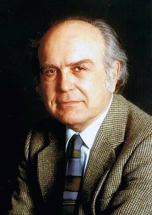

# 布鲁诺·祖米诺

**英文名：** Bruno Zumino

**生卒：** 1923年4月28日 — 2014年6月21日

**主要领域：** 超引力、量子场论

肖像的作者、拍摄或创作年代及具体形式见图片来源。

## 生平简介

意大利出生的理论物理学家，曾在CERN及加州大学伯克利分校工作。他将超对称从抽象代数推进为四维场论，并研究超引力和量子反常。

## 对物理的主要贡献

- 与韦斯建立四维超对称场论模型
- 与德泽尔独立构建超引力理论
- 发展规范反常的一致性条件研究

## 肖像来源与许可

- 来源：[modern-extra-bruno-zumino.jpg](https://news.berkeley.edu/2014/06/24/bruno-zumino-an-architect-of-supersymmetry-dies-at-91/)
- 作者／署名：见原图页面
- 许可：Copyrighted image; no transferable open licence verified. Permission must be confirmed before website publication.
- 本地文件：[c3cba465a9e501f2caf7-7d4054ca1c.jpg](../portraits/c3cba465a9e501f2caf7-7d4054ca1c.jpg)
- 原始来源说明：UC Berkeley News historical portrait
- 授权状态：仅记录来源与本地档案副本；未确认可用于网站再发布，发布前须向权利人核实授权。

## 资料来源

- [Bruno Zumino — Wikipedia reference biography](https://en.wikipedia.org/wiki/Bruno_Zumino)
- [ICTP Dirac Medal — official laureate directory](https://www.ictp.it/prize/dirac-medal)

资料整理日期：2026-10-26。
