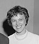

# 苏拉米特·戈德哈伯

**英文名：** Sulamith Goldhaber

**生卒：** 1923年11月4日 — 1965年12月11日

**主要领域：** 粒子物理、粒子探测

肖像的作者、拍摄或创作年代及具体形式见图片来源。

## 生平简介

奥地利出生的实验物理学家，曾在以色列学习，后在加州大学伯克利分校工作。她改进核乳胶和气泡室实验，以高能介子及奇异粒子研究著称。

## 对物理的主要贡献

- 发展高能粒子的核乳胶实验
- 研究K介子与核子相互作用
- 分析气泡室数据并研究强子共振态

## 肖像来源与许可

- 来源：[modern-extra-sulamith-goldhaber.jpeg](https://en.wikipedia.org/wiki/File:Sulamith_Goldhaber.jpeg)
- 作者／署名：见原图页面
- 许可：Non-free historical photograph hosted by English Wikipedia under its fair-use rationale; that rationale does not grant a reusable image licence. Permission must be confirmed before website publication.
- 本地文件：[f2cf409e8c7905e8dcaa-fd1412a362.jpeg](../portraits/f2cf409e8c7905e8dcaa-fd1412a362.jpeg)
- 原始来源说明：Historical photograph reproduced on English Wikipedia; see file record for original credit
- 授权状态：仅记录来源与本地档案副本；未确认可用于网站再发布，发布前须向权利人核实授权。

## 资料来源

- [Sulamith Goldhaber — Wikipedia reference biography](https://en.wikipedia.org/wiki/Sulamith_Goldhaber)
- [CWP at physics.UCLA.edu // Sulamith Goldhaber](http://cwp.library.ucla.edu/Phase2/Goldhaber,_Sulamith@812345678.html)
- [Sulamith Goldhaber (1923-1965)](http://cwp.library.ucla.edu/articles/goldhaber/tribute.html)

资料整理日期：2026-10-26。
