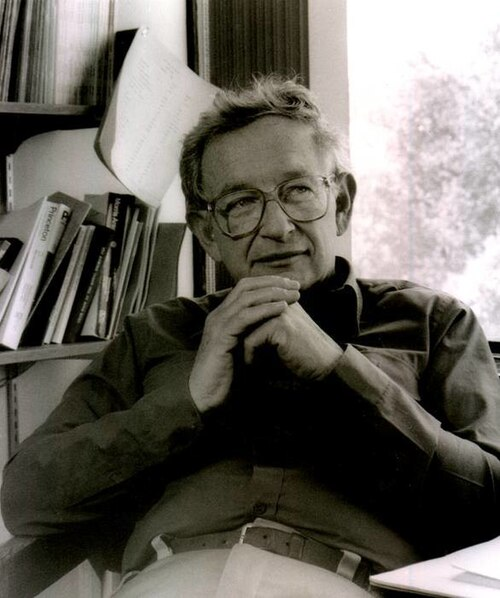

# 菲利普·安德森

**英文名：** Philip Warren Anderson

**生卒：** 1923年12月13日 — 2020年3月29日

**主要领域：** 凝聚态物理、无序体系

肖像的作者、拍摄或创作年代及具体形式见图片来源。

## 生平简介

菲利普·安德森出生于Indianapolis, IN, USA，主要从事凝聚态物理、无序体系研究。诺贝尔奖资料所列获奖时任职机构为Bell Telephone Laboratories。其代表成果包括提出安德森局域化，解释无序对电子传播的影响，获1977年诺贝尔物理学奖。

## 对物理的主要贡献

- 提出安德森局域化，解释无序对电子传播的影响
- 在磁性、超导和多体理论中作出重要贡献

**诺贝尔物理学奖：** 1977

## 肖像来源与许可

- 来源：[Andersonphoto.jpg](https://commons.wikimedia.org/wiki/File:Andersonphoto.jpg)
- 作者／署名：见原图页面
- 许可：Copyrighted free use
- 本地文件：[4b6949266b3706aab177.jpg](../portraits/4b6949266b3706aab177.jpg)
- 原始来源说明：I obtained this photo via email from Prof. Anderson himself

## 资料来源

- [Philip W. Anderson - Facts](https://www.nobelprize.org/prizes/physics/1977/anderson/facts/)
- [Nobel Prize official laureate API, id 107](https://api.nobelprize.org/2.1/laureate/107)
- [Wikipedia: Philip Warren Anderson](https://en.wikipedia.org/wiki/Philip_Warren_Anderson)

资料整理日期：2026-10-26。
