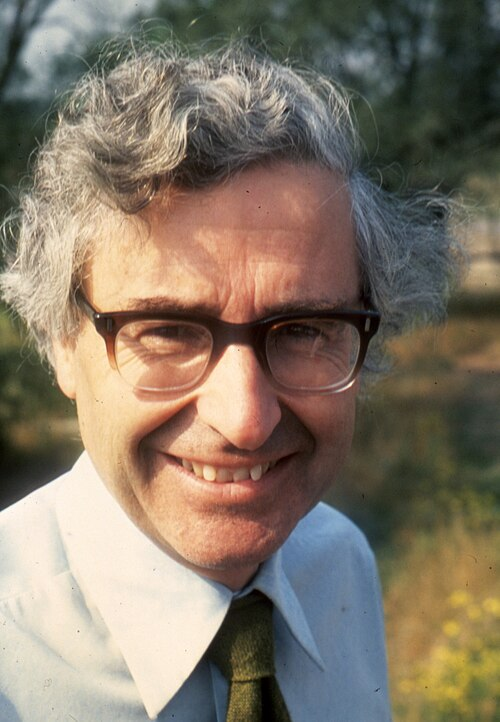

# 安东尼·休伊什

**英文名：** Antony Hewish

**生卒：** 1924年5月11日 — 2021年9月13日

**主要领域：** 射电天文学、脉冲星

肖像的作者、拍摄或创作年代及具体形式见图片来源。

## 生平简介

安东尼·休伊什出生于Fowey, United Kingdom，主要从事射电天文学、脉冲星研究。诺贝尔奖资料所列获奖时任职机构为University of Cambridge。其代表成果包括领导建造行星际闪烁射电阵列并参与脉冲星发现与解释，获1974年诺贝尔物理学奖。

## 对物理的主要贡献

- 领导建造行星际闪烁射电阵列并参与脉冲星发现与解释
- 乔斯琳·贝尔·伯内尔首先在阵列数据中辨认出异常脉冲信号

**诺贝尔物理学奖：** 1974

## 肖像来源与许可

- 来源：[Antony_Hewish_1976.jpg](https://commons.wikimedia.org/wiki/File:Antony_Hewish_1976.jpg)
- 作者／署名：AIP Emilio Segrè Visual Archives, John Irwin Slide Collection
- 许可：Attribution
- 本地文件：[2f2874fc42fd640ec598.jpg](../portraits/2f2874fc42fd640ec598.jpg)
- 原始来源说明：https://repository.aip.org/antony-hewish-3

## 资料来源

- [Antony Hewish - Facts](https://www.nobelprize.org/prizes/physics/1974/hewish/facts/)
- [Nobel Prize official laureate API, id 101](https://api.nobelprize.org/2.1/laureate/101)
- [Wikipedia: Antony Hewish](https://en.wikipedia.org/wiki/Antony_Hewish)

资料整理日期：2026-10-26。
