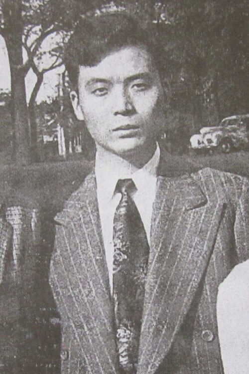

# 邓稼先

**英文名：** Deng Jiaxian

**生卒：** 1924年6月25日 — 1986年7月29日

**主要领域：** 核物理、核武器理论

肖像的作者、拍摄或创作年代及具体形式见图片来源。

## 生平简介

出生于安徽怀宁的理论物理学家，西南联合大学毕业后赴美国普渡大学取得博士学位，1950年回国。他长期在保密条件下工作，是中国核武器理论研究的重要组织者。

## 对物理的主要贡献

- 组织并参与中国首颗原子弹的物理设计和理论计算
- 参与中国氢弹原理与核武器理论研究
- 建立理论计算与实验验证相结合的研究队伍

## 肖像来源与许可

- 来源：[Deng_Jiaxian_1949.jpg](https://commons.wikimedia.org/wiki/File:Deng_Jiaxian_1949.jpg)
- 作者／署名：Unknown author
- 许可：Public domain
- 本地文件：[e30fab5301e924b5ab78.jpg](../portraits/e30fab5301e924b5ab78.jpg)
- 原始来源说明：National Museum of China

## 资料来源

- [Wikipedia: Deng Jiaxian](https://en.wikipedia.org/wiki/Deng_Jiaxian)

资料整理日期：2026-10-26。
