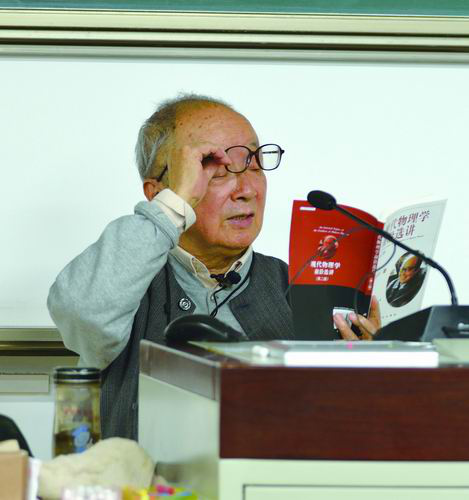

# 黄祖洽

**英文名：** Huang Zuqia

**生卒：** 1924年10月2日 — 2014年9月7日

**主要领域：** 核物理、反应堆理论

黄祖洽讲课时的单人照片；来源页图片说明为“黄祖洽 受访者供图”。

## 生平简介

出生于湖南长沙的理论物理学家，清华大学毕业后长期从事中国核科学理论研究，后在北京师范大学任教。他把基础理论、核能应用和高等教育相结合，参与早期核武器理论工作。

## 对物理的主要贡献

- 研究中子输运、反应堆理论及核能应用
- 参与中国核武器理论研究和计算
- 发展核物理及非平衡统计问题的教学研究

## 肖像来源与许可

- 来源：[W020241210547328883797.png](https://casad.cas.cn/mtbd2022/202412/t20241210_5042225.html)
- 作者／署名：摄影者未注明
- 许可：版权所有；网站再发布需另行确认授权
- 本地文件：[497abae477f953af3e96-26737cf7a8.png](../portraits/497abae477f953af3e96-26737cf7a8.png)
- 原始来源说明：中国科学报；中国科学院学部与院士网站转载；受访者供图
- 授权状态：仅记录来源与本地档案副本；未确认可用于网站再发布，发布前须向权利人核实授权。

## 资料来源

- [Wikipedia: Huang Zuqia](https://en.wikipedia.org/wiki/Huang_Zuqia)

资料整理日期：2026-10-26。
