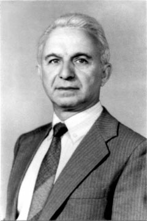

# 叶菲姆·弗拉德金

**英文名：** Efim Fradkin

**生卒：** 1924年11月30日 — 1999年5月25日

**主要领域：** 量子场论、统计物理

原样提取自《Physics–Uspekhi》1999年纪念文章第1页的本人肖像，图注标出其姓名及生卒日期。

## 生平简介

苏联及俄国理论物理学家，长期在列别捷夫物理研究所工作。他使用泛函方法研究相互作用场、量子统计和规范理论，并发展适用于复杂约束体系的量子化方法。

## 对物理的主要贡献

- 发展量子场论和量子统计的泛函方法
- 与合作者发展约束体系BRST量子化的BFV哈密顿形式
- 研究高自旋场及共形场论

## 肖像来源与许可

- 来源：[modern-extra-fradkin-photo-000.jpg](https://ufn.ru/ufn99/ufn99_11/ufn9911g.pdf)
- 作者／署名：见原图页面
- 许可：Copyrighted image; no transferable open licence verified. Permission must be confirmed before website publication.
- 本地文件：[d2e95509f5b00d5c100e-578a126bf5.jpg](../portraits/d2e95509f5b00d5c100e-578a126bf5.jpg)
- 原始来源说明：Physics–Uspekhi 42(11), 1175–1176 (1999), p. 1175; Uspekhi Fizicheskikh Nauk, Russian Academy of Sciences
- 授权状态：仅记录来源与本地档案副本；未确认可用于网站再发布，发布前须向权利人核实授权。

## 资料来源

- [Efim Fradkin — Wikipedia reference biography](https://en.wikipedia.org/wiki/Efim_Fradkin)

资料整理日期：2026-10-26。
