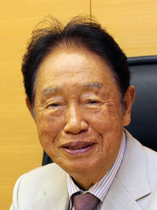

# 江崎玲于奈

**英文名：** Leo Esaki

**生卒：** 1925年3月12日 — 在世（截至资料整理日）

**主要领域：** 半导体物理、量子隧穿

肖像的作者、拍摄或创作年代及具体形式见图片来源。

## 生平简介

江崎玲于奈出生于Osaka, Japan，主要从事半导体物理、量子隧穿研究。诺贝尔奖资料所列获奖时任职机构为IBM Thomas J. Watson Research Center。其代表成果包括发现重掺杂半导体结中的电子隧穿效应，获1973年诺贝尔物理学奖。

## 对物理的主要贡献

- 发现重掺杂半导体结中的电子隧穿效应
- 研制江崎隧道二极管

**诺贝尔物理学奖：** 1973

## 肖像来源与许可

- 来源：[Esaki_leo_Gakushiin.jpg](https://commons.wikimedia.org/wiki/File:Esaki_leo_Gakushiin.jpg)
- 作者／署名：日本学士院
- 许可：[CC BY 4.0](https://creativecommons.org/licenses/by/4.0)
- 本地文件：[5008e1d2277338d5ed05.jpg](../portraits/5008e1d2277338d5ed05.jpg)
- 原始来源说明：会員情報 | 日本学士院

## 资料来源

- [Leo Esaki - Facts](https://www.nobelprize.org/prizes/physics/1973/esaki/facts/)
- [Nobel Prize official laureate API, id 97](https://api.nobelprize.org/2.1/laureate/97)
- [Wikipedia: Leo Esaki](https://en.wikipedia.org/wiki/Leo_Esaki)

资料整理日期：2026-10-26。
