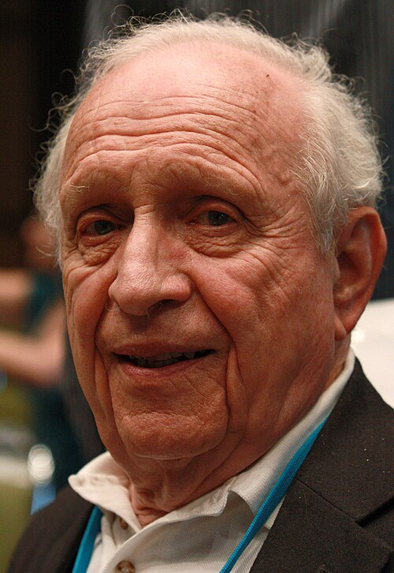

# 罗伊·格劳伯

**英文名：** Roy J. Glauber

**生卒：** 1925年9月1日 — 2018年12月26日

**主要领域：** 量子光学

肖像的作者、拍摄或创作年代及具体形式见图片来源。

## 生平简介

罗伊·格劳伯出生于New York, NY, USA，主要从事量子光学研究。诺贝尔奖资料所列获奖时任职机构为Harvard University。其代表成果包括建立光学相干的量子理论，获2005年诺贝尔物理学奖。

## 对物理的主要贡献

- 建立光学相干的量子理论
- 以量子关联函数描述光子统计和光的相干性质

**诺贝尔物理学奖：** 2005

## 肖像来源与许可

- 来源：[Roy_Glauber.jpg](https://commons.wikimedia.org/wiki/File:Roy_Glauber.jpg)
- 作者／署名：Markus Pössel (User name: Mapos)
- 许可：[CC BY-SA 3.0](https://commons.wikimedia.org/wiki/File:Roy_Glauber.jpg)
- 本地文件：[87acdc4cc95ac78f61b9.jpg](../portraits/87acdc4cc95ac78f61b9.jpg)
- 原始来源说明：Own work

## 资料来源

- [Roy J. Glauber - Facts](https://www.nobelprize.org/prizes/physics/2005/glauber/facts/)
- [Nobel Prize official laureate API, id 791](https://api.nobelprize.org/2.1/laureate/791)
- [Wikipedia: Roy J. Glauber](https://en.wikipedia.org/wiki/Roy_J._Glauber)

资料整理日期：2026-10-26。
