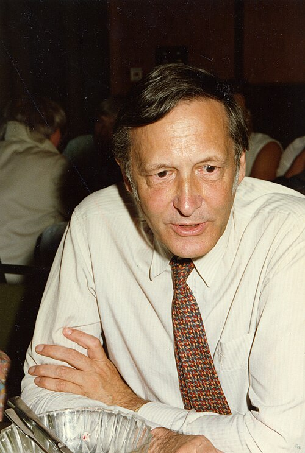

# 西蒙·范德梅尔

**英文名：** Simon van der Meer

**生卒：** 1925年11月24日 — 2011年3月4日

**主要领域：** 加速器物理

肖像的作者、拍摄或创作年代及具体形式见图片来源。

## 生平简介

西蒙·范德梅尔出生于the Hague, the Netherlands，主要从事加速器物理研究。诺贝尔奖资料所列获奖时任职机构为CERN。其代表成果包括发明随机冷却方法，获1984年诺贝尔物理学奖。

## 对物理的主要贡献

- 发明随机冷却方法
- 使高强度反质子束及发现W和Z玻色子的对撞实验成为可能

**诺贝尔物理学奖：** 1984

## 肖像来源与许可

- 来源：[Simon_van_der_Meer.jpg](https://commons.wikimedia.org/wiki/File:Simon_van_der_Meer.jpg)
- 作者／署名：AIP Emilio Segrè Visual Archives, Segrè Collection
- 许可：Attribution
- 本地文件：[964f6549d52ff8fcb3c1.jpg](../portraits/964f6549d52ff8fcb3c1.jpg)
- 原始来源说明：https://repository.aip.org/portrait-van-der-meer

## 资料来源

- [Simon van der Meer - Facts](https://www.nobelprize.org/prizes/physics/1984/meer/facts/)
- [Nobel Prize official laureate API, id 125](https://api.nobelprize.org/2.1/laureate/125)
- [Wikipedia: Simon van der Meer](https://en.wikipedia.org/wiki/Simon_van_der_Meer)

资料整理日期：2026-10-26。
