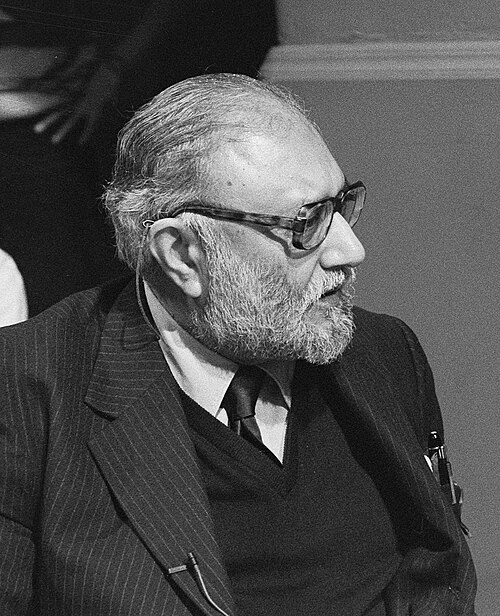

# 阿卜杜勒·萨拉姆

**英文名：** Abdus Salam

**生卒：** 1926年1月29日 — 1996年11月21日

**主要领域：** 粒子物理、电弱理论

肖像的作者、拍摄或创作年代及具体形式见图片来源。

## 生平简介

阿卜杜勒·萨拉姆出生于Jhang Maghiāna, India (now Pakistan)，主要从事粒子物理、电弱理论研究。诺贝尔奖资料所列获奖时任职机构为International Centre for Theoretical Physics、Imperial College。其代表成果包括发展统一描述电磁相互作用和弱相互作用的理论，获1979年诺贝尔物理学奖。

## 对物理的主要贡献

- 发展统一描述电磁相互作用和弱相互作用的理论
- 预言和解释弱中性流等现象

**诺贝尔物理学奖：** 1979

## 肖像来源与许可

- 来源：[Abdus_Salam_1987.jpg](https://commons.wikimedia.org/wiki/File:Abdus_Salam_1987.jpg)
- 作者／署名：Molendijk, Bart / Anefo
- 许可：[CC BY-SA 3.0 nl](https://creativecommons.org/licenses/by-sa/3.0/nl/deed.en)
- 本地文件：[62c91d4e6bdb9f872406.jpg](../portraits/62c91d4e6bdb9f872406.jpg)
- 原始来源说明：Dutch National Archives, The Hague, Fotocollectie Algemeen Nederlands Persbureau (ANeFo), 1945-1989, Nummer toegang 2.24.01.05 Bestanddeelnummer 933-9976

## 资料来源

- [Abdus Salam - Facts](https://www.nobelprize.org/prizes/physics/1979/salam/facts/)
- [Nobel Prize official laureate API, id 114](https://api.nobelprize.org/2.1/laureate/114)
- [Wikipedia: Abdus Salam](https://en.wikipedia.org/wiki/Abdus_Salam)

资料整理日期：2026-10-26。
