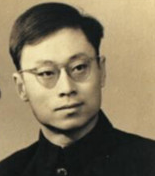

# 于敏

**英文名：** Yu Min

**生卒：** 1926年8月16日 — 2019年1月16日

**主要领域：** 核物理、理论物理

肖像的作者、拍摄或创作年代及具体形式见图片来源。

## 生平简介

出生于天津的理论物理学家，北京大学毕业后进入中国科学院近代物理研究所，长期从事原子核理论和核武器理论研究。他在高度保密条件下参与中国氢弹原理探索与设计。

## 对物理的主要贡献

- 研究原子核结构与轻核反应机制
- 在中国氢弹原理突破及理论方案形成中发挥关键作用
- 推动核武器理论计算与物理设计

## 肖像来源与许可

- 来源：[于敏夫婦舊照片_(cropped).png](https://commons.wikimedia.org/wiki/File:%E4%BA%8E%E6%95%8F%E5%A4%AB%E5%A9%A6%E8%88%8A%E7%85%A7%E7%89%87_(cropped).png)
- 作者／署名：Unknown author
- 许可：Public domain
- 本地文件：[9fe1fa49fdd8ee98495c.png](../portraits/9fe1fa49fdd8ee98495c.png)
- 原始来源说明：http://www.hebradio.com/app/news/2015/0114/636540.json.html

## 资料来源

- [Wikipedia: Yu Min (physicist)](https://en.wikipedia.org/wiki/Yu_Min_(physicist))

资料整理日期：2026-10-26。
