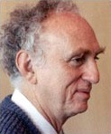

# 马丁·珀尔

**英文名：** Martin L. Perl

**生卒：** 1927年6月24日 — 2014年9月30日

**主要领域：** 粒子物理、轻子

肖像的作者、拍摄或创作年代及具体形式见图片来源。

## 生平简介

马丁·珀尔出生于New York, NY, USA，主要从事粒子物理、轻子研究。诺贝尔奖资料所列获奖时任职机构为Stanford University。其代表成果包括在电子正电子对撞实验中发现τ轻子，获1995年诺贝尔物理学奖。

## 对物理的主要贡献

- 在电子正电子对撞实验中发现τ轻子
- 揭示带电轻子的第三代成员

**诺贝尔物理学奖：** 1995

## 肖像来源与许可

- 来源：[Martin_Perl_-_tau.jpg](https://commons.wikimedia.org/wiki/File:Martin_Perl_-_tau.jpg)
- 作者／署名：Unknown author
- 许可：Public domain
- 本地文件：[9baf8b61ccb14633c709.jpg](../portraits/9baf8b61ccb14633c709.jpg)
- 原始来源说明：http://www.fnal.gov/pub/inquiring/timeline/

## 资料来源

- [Martin L. Perl - Facts](https://www.nobelprize.org/prizes/physics/1995/perl/facts/)
- [Nobel Prize official laureate API, id 147](https://api.nobelprize.org/2.1/laureate/147)
- [Wikipedia: Martin Lewis Perl](https://en.wikipedia.org/wiki/Martin_Lewis_Perl)

资料整理日期：2026-10-26。
