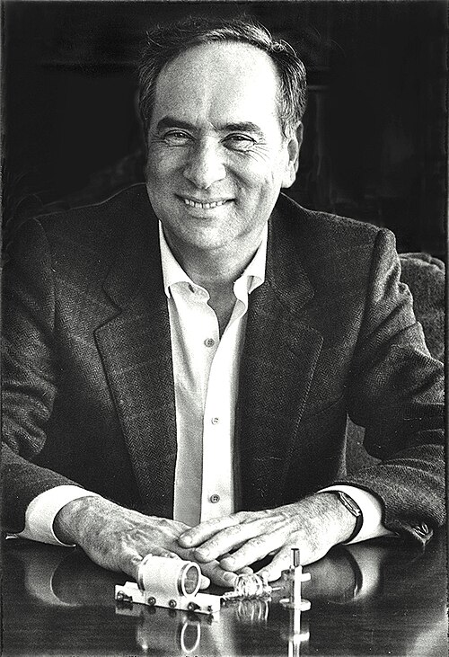

# 西奥多·梅曼

**英文名：** Theodore Maiman

**生卒：** 1927年7月11日 — 2007年5月5日

**主要领域：** 激光物理、量子电子学

肖像的作者、拍摄或创作年代及具体形式见图片来源。

## 生平简介

美国实验物理学家，曾在斯坦福大学师从兰姆，后在休斯研究实验室工作。他使用红宝石介质研制出首台可工作的激光器，并推动激光技术走向实际应用。

## 对物理的主要贡献

- 1960年实现首台可工作的红宝石激光器
- 研究固体激光介质及光泵浦方法
- 推动激光器的工程开发与应用

## 肖像来源与许可

- 来源：[Maiman_with_the_first_laser.jpg](https://commons.wikimedia.org/wiki/File:Maiman_with_the_first_laser.jpg)
- 作者／署名：Unknown author
- 许可：[CC BY-SA 4.0](https://creativecommons.org/licenses/by-sa/4.0)
- 本地文件：[4a87405ca29ef4222a28-cecd351c69.jpg](../portraits/4a87405ca29ef4222a28-cecd351c69.jpg)
- 原始来源说明：Press photo taken for the periodical Los Angeles Reader, 1985

## 资料来源

- [Theodore Maiman — National MagLab](https://maglabweb.magnet.fsu.edu/magnet-academy/history-of-electricity-magnetism/pioneers/theodore-maiman/)
- [Theodore Maiman — Wikipedia reference biography](https://en.wikipedia.org/wiki/Theodore_Maiman)

资料整理日期：2026-10-26。
