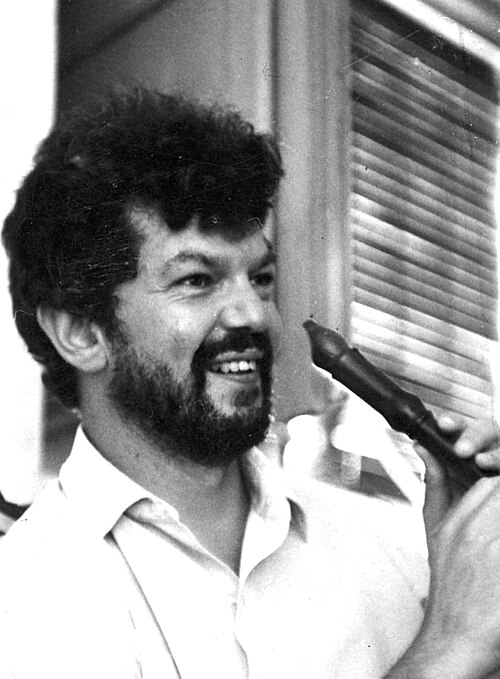

# 罗伯特·布劳特

**英文名：** Robert Brout

**生卒：** 1928年6月14日 — 2011年5月3日

**主要领域：** 粒子物理、统计物理

肖像的作者、拍摄或创作年代及具体形式见图片来源。

## 生平简介

美国出生的比利时理论物理学家，曾在康奈尔大学工作，后长期任教于布鲁塞尔自由大学。他与恩格勒合作研究自发对称性破缺，是规范玻色子质量机制的提出者之一。

## 对物理的主要贡献

- 与恩格勒提出规范理论中的自发对称性破缺机制
- 说明规范场可通过标量场获得质量
- 研究相变、统计物理及宇宙学问题

## 肖像来源与许可

- 来源：[Robert_Brout.jpg](https://commons.wikimedia.org/wiki/File:Robert_Brout.jpg)
- 作者／署名：Pnicolet at en.wikipedia
- 许可：[CC BY-SA 3.0](http://creativecommons.org/licenses/by-sa/3.0/)
- 本地文件：[6ebe3b861f0f498b9768.jpg](../portraits/6ebe3b861f0f498b9768.jpg)
- 原始来源说明：Own work Transferred from en.wikipedia to Commons by User:Magnus Manske using CommonsHelper.

## 资料来源

- [恩格勒撰写的Robert Brout讣告（Physics Today）](https://physicstoday.aip.org/obituaries/robert-brout)
- [Wikipedia: Robert Brout](https://en.wikipedia.org/wiki/Robert_Brout)

资料整理日期：2026-10-26。
