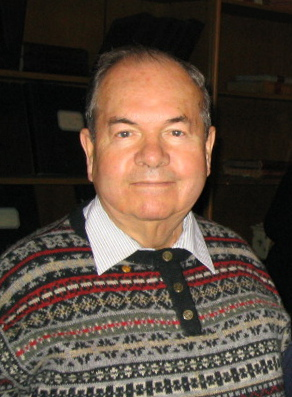

# 阿列克谢·阿布里科索夫

**英文名：** Alexei Alexeyevich Abrikosov

**生卒：** 1928年6月25日 — 2017年3月29日

**主要领域：** 凝聚态物理、超导

肖像的作者、拍摄或创作年代及具体形式见图片来源。

## 生平简介

阿列克谢·阿布里科索夫出生于Moscow, USSR (now Russia)，主要从事凝聚态物理、超导研究。诺贝尔奖资料所列获奖时任职机构为Argonne National Laboratory。其代表成果包括建立第二类超导体的涡旋理论，获2003年诺贝尔物理学奖。

## 对物理的主要贡献

- 建立第二类超导体的涡旋理论
- 解释磁通以量子化涡旋形式进入超导体的混合态

**诺贝尔物理学奖：** 2003

## 肖像来源与许可

- 来源：[AA_Abrikosov_ANL1.jpg](https://commons.wikimedia.org/wiki/File:AA_Abrikosov_ANL1.jpg)
- 作者／署名：AA_Abrikosov_and_VL_Ginzburg_ANL.jpg: ANL.gov derivative work: Materialscientist
- 许可：Public domain
- 本地文件：[2f61682140158ce5125e.jpg](../portraits/2f61682140158ce5125e.jpg)
- 原始来源说明：This file was derived from: AA Abrikosov and VL Ginzburg ANL.jpg:

## 资料来源

- [Alexei Abrikosov - Facts](https://www.nobelprize.org/prizes/physics/2003/abrikosov/facts/)
- [Nobel Prize official laureate API, id 766](https://api.nobelprize.org/2.1/laureate/766)
- [Wikipedia: Alexei Alexeyevich Abrikosov](https://en.wikipedia.org/wiki/Alexei_Alexeyevich_Abrikosov)

资料整理日期：2026-10-26。
