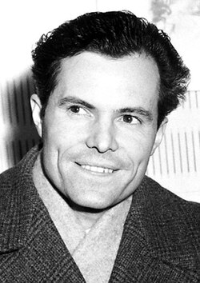

# 鲁道夫·穆斯堡尔

**英文名：** Rudolf Ludwig Mössbauer

**生卒：** 1929年1月31日 — 2011年9月14日

**主要领域：** 核物理、精密光谱

肖像的作者、拍摄或创作年代及具体形式见图片来源。

## 生平简介

鲁道夫·穆斯堡尔出生于Munich, Germany，主要从事核物理、精密光谱研究。诺贝尔奖资料所列获奖时任职机构为Technical University、California Institute of Technology (Caltech)。其代表成果包括发现原子核无反冲吸收和发射γ射线的穆斯堡尔效应，获1961年诺贝尔物理学奖。

## 对物理的主要贡献

- 发现原子核无反冲吸收和发射γ射线的穆斯堡尔效应
- 建立可用于精密能量测量和物质研究的共振光谱方法

**诺贝尔物理学奖：** 1961

## 肖像来源与许可

- 来源：[Mossbauer.jpg](https://commons.wikimedia.org/wiki/File:Mossbauer.jpg)
- 作者／署名：Nobel foundation
- 许可：Public domain
- 本地文件：[fedd95df8071d6966bc1.jpg](../portraits/fedd95df8071d6966bc1.jpg)
- 原始来源说明：http://nobelprize.org/nobel_prizes/physics/laureates/1961/mossbauer-bio.html

## 资料来源

- [Rudolf Mössbauer - Facts](https://www.nobelprize.org/prizes/physics/1961/mossbauer/facts/)
- [Nobel Prize official laureate API, id 76](https://api.nobelprize.org/2.1/laureate/76)
- [Wikipedia: Rudolf Mössbauer](https://en.wikipedia.org/wiki/Rudolf_M%C3%B6ssbauer)

资料整理日期：2026-10-26。
