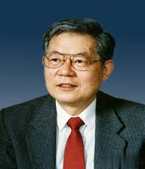

# 周光召

**英文名：** Zhou Guangzhao

**生卒：** 1929年5月15日 — 2024年8月17日

**主要领域：** 粒子物理、核物理

已核对对应人物条目使用的历史肖像；图像文件来自英语维基百科本地文件库。

## 生平简介

出生于湖南长沙的理论物理学家，曾在清华大学、北京大学及杜布纳联合核子研究所学习工作。回国后参与核武器理论研究，后来担任中国科学院院长，推动基础研究和国际交流。

## 对物理的主要贡献

- 参与建立赝矢量流部分守恒思想
- 研究相对论散射振幅与螺旋度方法
- 组织并参与中国核武器理论和辐射流体力学研究

## 肖像来源与许可

- 来源：[Zhou_Guangzhao.jpeg](https://en.wikipedia.org/wiki/File:Zhou_Guangzhao.jpeg)
- 作者／署名：见原图页面
- 许可：非自由历史照片或版权状态未确认；公开网页使用前需核查授权
- 本地文件：[e145000ce5dd4384b8a8-b86c69176c.jpeg](../portraits/e145000ce5dd4384b8a8-b86c69176c.jpeg)
- 授权状态：仅记录来源与本地档案副本；未确认可用于网站再发布，发布前须向权利人核实授权。

## 资料来源

- [中国科学院理论物理研究所：周光召院士简介](https://www.itp.cas.cn/ztlm/zszt/ztzgz/202208/t20220822_6502343.html)
- [Wikipedia: Zhou Guangzhao](https://en.wikipedia.org/wiki/Zhou_Guangzhao)

资料整理日期：2026-10-26。
