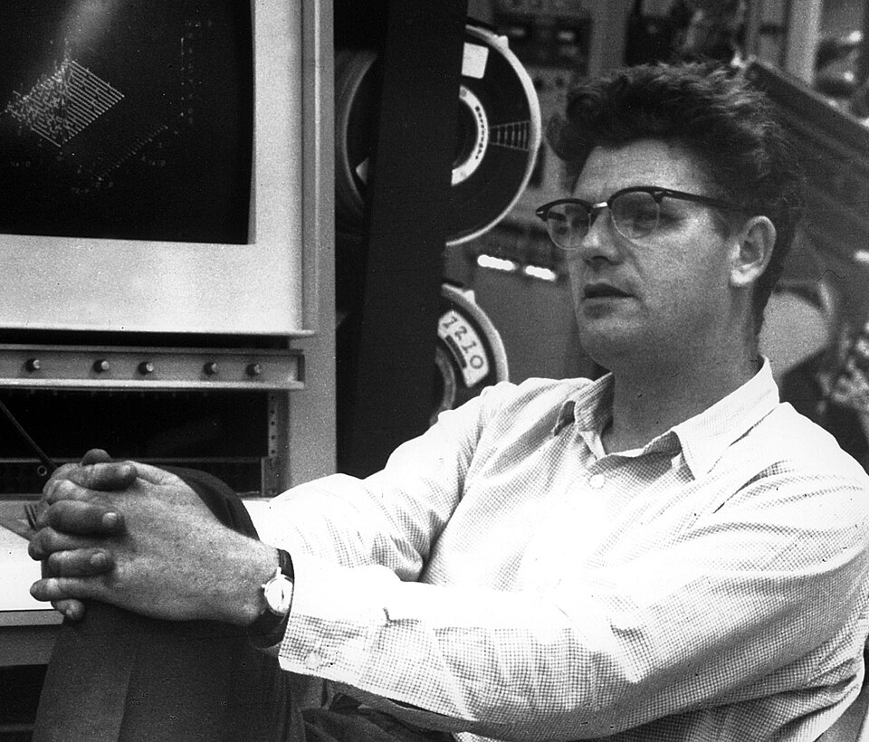

# 理查德·爱德华·泰勒

**英文名：** Richard E. Taylor

**生卒：** 1929年11月2日 — 2018年2月22日

**主要领域：** 粒子物理、深度非弹性散射

肖像的作者、拍摄或创作年代及具体形式见图片来源。

## 生平简介

理查德·爱德华·泰勒出生于Medicine Hat, Alberta, Canada，主要从事粒子物理、深度非弹性散射研究。诺贝尔奖资料所列获奖时任职机构为Stanford University。其代表成果包括通过高能电子与核子深度非弹性散射揭示核子内部结构，获1990年诺贝尔物理学奖。

## 对物理的主要贡献

- 通过高能电子与核子深度非弹性散射揭示核子内部结构
- 为夸克作为核子组成部分提供关键证据

**诺贝尔物理学奖：** 1990

## 肖像来源与许可

- 来源：[Richard_E._Taylor.jpg](https://commons.wikimedia.org/wiki/File:Richard_E._Taylor.jpg)
- 作者／署名：ENERGY.GOV
- 许可：Public domain
- 本地文件：[5d940a79c3e37b724814.jpg](../portraits/5d940a79c3e37b724814.jpg)
- 原始来源说明：HD.3F.009

## 资料来源

- [Richard E. Taylor - Facts](https://www.nobelprize.org/prizes/physics/1990/taylor/facts/)
- [Nobel Prize official laureate API, id 140](https://api.nobelprize.org/2.1/laureate/140)
- [Wikipedia: Richard E. Taylor](https://en.wikipedia.org/wiki/Richard_E._Taylor)

资料整理日期：2026-10-26。
