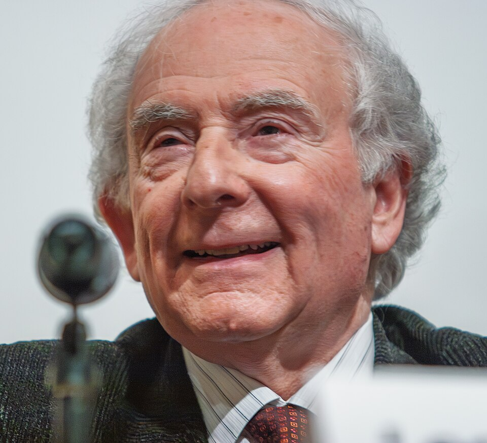

# 利昂·库珀

**英文名：** Leon Neil Cooper

**生卒：** 1930年2月28日 — 2024年10月23日

**主要领域：** 凝聚态物理、超导

肖像的作者、拍摄或创作年代及具体形式见图片来源。

## 生平简介

利昂·库珀出生于New York, NY, USA，主要从事凝聚态物理、超导研究。诺贝尔奖资料所列获奖时任职机构为Brown University。其代表成果包括共同建立超导电性的BCS微观理论，获1972年诺贝尔物理学奖。

## 对物理的主要贡献

- 共同建立超导电性的BCS微观理论
- 用电子成对及其凝聚解释常规超导现象

**诺贝尔物理学奖：** 1972

## 肖像来源与许可

- 来源：[Nobel_Laureate_Leon_Cooper_in_2007.jpg](https://commons.wikimedia.org/wiki/File:Nobel_Laureate_Leon_Cooper_in_2007.jpg)
- 作者／署名：Kenneth C. Zirkel
- 许可：[CC BY-SA 3.0](https://commons.wikimedia.org/wiki/File:Nobel_Laureate_Leon_Cooper_in_2007.jpg)
- 本地文件：[f47ecc56e955c6f6871e.jpg](../portraits/f47ecc56e955c6f6871e.jpg)
- 原始来源说明：Own work

## 资料来源

- [Leon N. Cooper - Facts](https://www.nobelprize.org/prizes/physics/1972/cooper/facts/)
- [Nobel Prize official laureate API, id 95](https://api.nobelprize.org/2.1/laureate/95)
- [Wikipedia: Leon Cooper](https://en.wikipedia.org/wiki/Leon_Cooper)

资料整理日期：2026-10-26。
