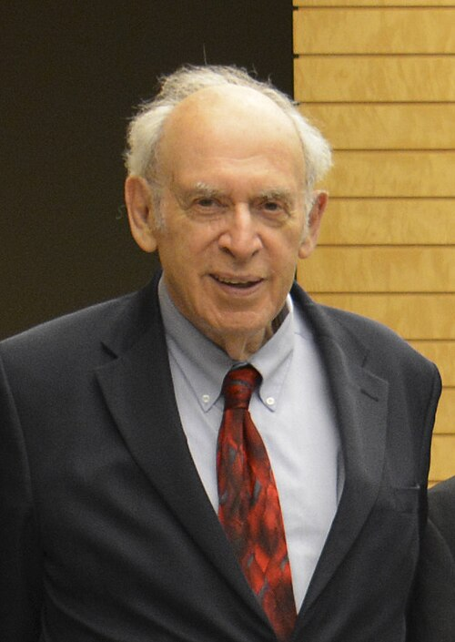

# 杰尔姆·弗里德曼

**英文名：** Jerome I. Friedman

**生卒：** 1930年3月28日 — 在世（截至资料整理日）

**主要领域：** 粒子物理、深度非弹性散射

肖像的作者、拍摄或创作年代及具体形式见图片来源。

## 生平简介

杰尔姆·弗里德曼出生于Chicago, IL, USA，主要从事粒子物理、深度非弹性散射研究。诺贝尔奖资料所列获奖时任职机构为Massachusetts Institute of Technology (MIT)。其代表成果包括通过高能电子与核子深度非弹性散射揭示核子内部结构，获1990年诺贝尔物理学奖。

## 对物理的主要贡献

- 通过高能电子与核子深度非弹性散射揭示核子内部结构
- 为夸克作为核子组成部分提供关键证据

**诺贝尔物理学奖：** 1990

## 肖像来源与许可

- 来源：[OIST_BOG_Members_After_Meeting_Prime_Minister_Shinzo_Abe_4_October_2013_20131004_(cropped).jpg](https://commons.wikimedia.org/wiki/File:OIST_BOG_Members_After_Meeting_Prime_Minister_Shinzo_Abe_4_October_2013_20131004_%28cropped%29.jpg)
- 作者／署名：Copyright OIST (Okinawa Institute of Science and Technology Graduate University, 沖縄科学技術大学院大学)
- 许可：[CC BY 4.0](https://commons.wikimedia.org/wiki/Commons:Non-copyright_restrictions)
- 本地文件：[97e10661fc3160c6fab2.jpg](../portraits/97e10661fc3160c6fab2.jpg)
- 原始来源说明：安倍晋三総理大臣との会談後のOIST理事会メンバーたち（2013年10月4日） | 沖縄科学技術大学院大学（OIST）

## 资料来源

- [Jerome I. Friedman - Facts](https://www.nobelprize.org/prizes/physics/1990/friedman/facts/)
- [Nobel Prize official laureate API, id 138](https://api.nobelprize.org/2.1/laureate/138)
- [Wikipedia: Jerome Isaac Friedman](https://en.wikipedia.org/wiki/Jerome_Isaac_Friedman)

资料整理日期：2026-10-26。
