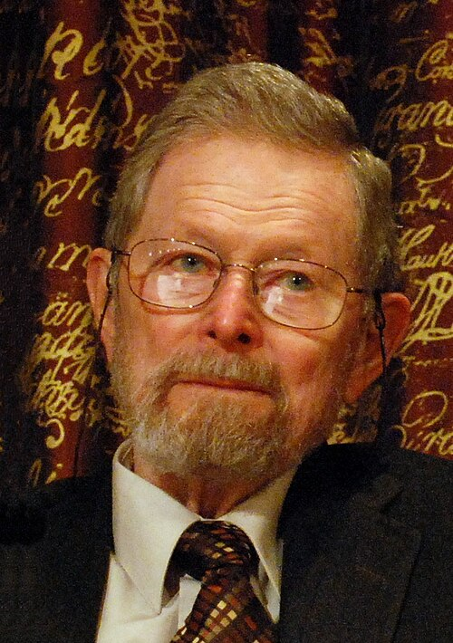

# 乔治·史密斯

**英文名：** George E. Smith

**生卒：** 1930年5月10日 — 2025年5月28日

**主要领域：** 半导体物理、成像器件

肖像的作者、拍摄或创作年代及具体形式见图片来源。

## 生平简介

乔治·史密斯出生于White Plains, NY, USA，主要从事半导体物理、成像器件研究。诺贝尔奖资料所列获奖时任职机构为Bell Laboratories。其代表成果包括与威拉德·博伊尔共同发明CCD图像传感器，获2009年诺贝尔物理学奖。

## 对物理的主要贡献

- 与威拉德·博伊尔共同发明CCD图像传感器
- 将光信号转换为可逐级转移读出的电荷信号

**诺贝尔物理学奖：** 2009

## 肖像来源与许可

- 来源：[Nobel_Prize_2009-Press_Conference_KVA-27.jpg](https://commons.wikimedia.org/wiki/File:Nobel_Prize_2009-Press_Conference_KVA-27.jpg)
- 作者／署名：Prolineserver (talk)
- 许可：[CC BY-SA 3.0](https://commons.wikimedia.org/wiki/Commons:Credit_line)
- 本地文件：[20a1ec7669e02a461888.jpg](../portraits/20a1ec7669e02a461888.jpg)
- 原始来源说明：Own work

## 资料来源

- [George E. Smith - Facts](https://www.nobelprize.org/prizes/physics/2009/smith/facts/)
- [Nobel Prize official laureate API, id 840](https://api.nobelprize.org/2.1/laureate/840)
- [Wikipedia: George E. Smith](https://en.wikipedia.org/wiki/George_E._Smith)

资料整理日期：2026-10-26。
