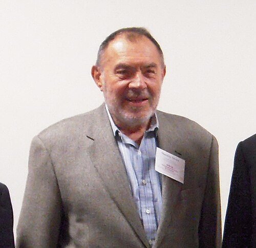

# 斯坦利·德泽尔

**英文名：** Stanley Deser

**生卒：** 1931年3月19日 — 2023年4月21日

**主要领域：** 广义相对论、超引力

肖像的作者、拍摄或创作年代及具体形式见图片来源。

## 生平简介

波兰出生的美国理论物理学家，长期在布兰戴斯大学工作。他研究引力的正则形式、超引力及场论的一致性，对广义相对论与量子场论的联系作出重要贡献。

## 对物理的主要贡献

- 与阿诺维特、米斯纳建立引力的ADM正则形式
- 与祖米诺独立构建超引力理论
- 研究引力及高自旋场理论的一致性

## 肖像来源与许可

- 来源：[StanleyDeser2009_01.jpg](https://commons.wikimedia.org/wiki/File:StanleyDeser2009_01.jpg)
- 作者／署名：Puzhok
- 许可：[CC BY-SA 3.0](https://creativecommons.org/licenses/by-sa/3.0)
- 本地文件：[1d048153c18de664023d-731296a38b.jpg](../portraits/1d048153c18de664023d-731296a38b.jpg)
- 原始来源说明：Own work

## 资料来源

- [Stanley Deser — Wikipedia reference biography](https://en.wikipedia.org/wiki/Stanley_Deser)

资料整理日期：2026-10-26。
