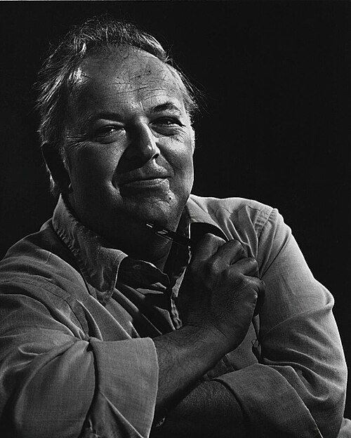

# 伯顿·里克特

**英文名：** Burton Richter

**生卒：** 1931年3月22日 — 2018年7月18日

**主要领域：** 粒子物理、实验物理

肖像的作者、拍摄或创作年代及具体形式见图片来源。

## 生平简介

伯顿·里克特出生于Brooklyn, NY, USA，主要从事粒子物理、实验物理研究。诺贝尔奖资料所列获奖时任职机构为Stanford Linear Accelerator Center。其代表成果包括分别领导实验发现J/ψ粒子，获1976年诺贝尔物理学奖。

## 对物理的主要贡献

- 分别领导实验发现J/ψ粒子
- 为粲夸克及夸克模型提供关键证据

**诺贝尔物理学奖：** 1976

## 肖像来源与许可

- 来源：[Burton_Richter_1976_by_Eddie_Adams.jpg](https://commons.wikimedia.org/wiki/File:Burton_Richter_1976_by_Eddie_Adams.jpg)
- 作者／署名：Eddie Adams
- 许可：Public domain
- 本地文件：[192684388c5c21f7b2b3.jpg](../portraits/192684388c5c21f7b2b3.jpg)
- 原始来源说明：https://www.alamy.com/professor-burton-richter-of-stanford-university-won-the-nobel-prize-for-physics-nov-29-1976-using-different-experimental-methods-and-acting-independently-of-co-winner-prof-samuel-ting-both-discovered-the-smallest-component-of-matter-smaller-than-atoms-and-their-nuclei-fragments-known-as-j-particles-ap-photoeddie-adams-image517843984.html

## 资料来源

- [Burton Richter - Facts](https://www.nobelprize.org/prizes/physics/1976/richter/facts/)
- [Nobel Prize official laureate API, id 105](https://api.nobelprize.org/2.1/laureate/105)
- [Wikipedia: Burton Richter](https://en.wikipedia.org/wiki/Burton_Richter)

资料整理日期：2026-10-26。
