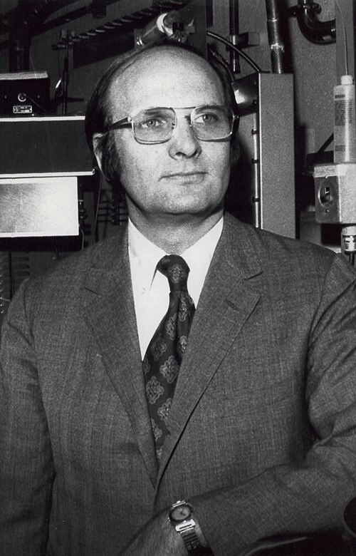

# 约翰·施里弗

**英文名：** John Robert Schrieffer

**生卒：** 1931年5月31日 — 2019年7月27日

**主要领域：** 凝聚态物理、超导

肖像的作者、拍摄或创作年代及具体形式见图片来源。

## 生平简介

约翰·施里弗出生于Oak Park, IL, USA，主要从事凝聚态物理、超导研究。诺贝尔奖资料所列获奖时任职机构为University of Pennsylvania。其代表成果包括共同建立超导电性的BCS微观理论，获1972年诺贝尔物理学奖。

## 对物理的主要贡献

- 共同建立超导电性的BCS微观理论
- 用电子成对及其凝聚解释常规超导现象

**诺贝尔物理学奖：** 1972

## 肖像来源与许可

- 来源：[John_Robert_Schrieffer_1972.jpg](https://commons.wikimedia.org/wiki/File:John_Robert_Schrieffer_1972.jpg)
- 作者／署名：Unknown author
- 许可：[CC BY-SA 3.0 nl](https://commons.wikimedia.org/wiki/File:John_Robert_Schrieffer_1972.jpg)
- 本地文件：[6465d79e08a402c541b3.jpg](../portraits/6465d79e08a402c541b3.jpg)
- 原始来源说明：[1] Dutch National Archives, The Hague, Fotocollectie Algemeen Nederlands Persbureau (ANEFO), 1945-1989

## 资料来源

- [Robert Schrieffer - Facts](https://www.nobelprize.org/prizes/physics/1972/schrieffer/facts/)
- [Nobel Prize official laureate API, id 96](https://api.nobelprize.org/2.1/laureate/96)
- [Wikipedia: John Robert Schrieffer](https://en.wikipedia.org/wiki/John_Robert_Schrieffer)

资料整理日期：2026-10-26。
