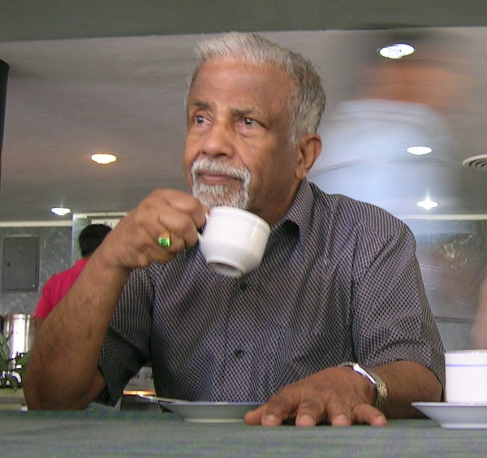

# 乔治·苏达山

**英文名：** E. C. George Sudarshan

**生卒：** 1931年9月16日 — 2018年5月13日

**主要领域：** 粒子物理、量子光学

肖像的作者、拍摄或创作年代及具体形式见图片来源。

## 生平简介

印度出生的理论物理学家，先后在美国罗切斯特、哈佛和得克萨斯大学等机构工作。他横跨弱相互作用、量子光学与开放量子体系研究，并长期参与印度科学建设。

## 对物理的主要贡献

- 与马沙克提出弱相互作用的V−A理论
- 建立量子光学中的对角相干态表示
- 参与发展开放量子体系的动力学映射理论

## 肖像来源与许可

- 来源：[ECG_Sudarshan.jpg](https://commons.wikimedia.org/wiki/File:ECG_Sudarshan.jpg)
- 作者／署名：Tabish q at English Wikipedia
- 许可：[CC BY-SA 3.0](https://en.wikipedia.org/wiki/en:GNU_Free_Documentation_License)
- 本地文件：[f681cca7a757d83d9058.jpg](../portraits/f681cca7a757d83d9058.jpg)
- 原始来源说明：Transferred from en.wikipedia to Commons.

## 资料来源

- [Wikipedia: E. C. George Sudarshan](https://en.wikipedia.org/wiki/E._C._George_Sudarshan)

资料整理日期：2026-10-26。
