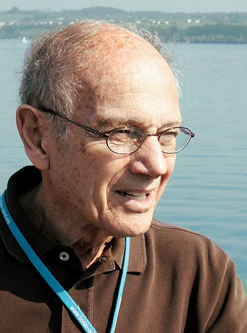

# 詹姆斯·克罗宁

**英文名：** James Watson Cronin

**生卒：** 1931年9月29日 — 2016年8月25日

**主要领域：** 粒子物理、CP对称性

肖像的作者、拍摄或创作年代及具体形式见图片来源。

## 生平简介

詹姆斯·克罗宁出生于Chicago, IL, USA，主要从事粒子物理、CP对称性研究。诺贝尔奖资料所列获奖时任职机构为University of Chicago。其代表成果包括发现中性K介子衰变中的CP对称性破坏，获1980年诺贝尔物理学奖。

## 对物理的主要贡献

- 发现中性K介子衰变中的CP对称性破坏
- 表明自然界部分过程不保持电荷共轭与空间反演的联合对称

**诺贝尔物理学奖：** 1980

## 肖像来源与许可

- 来源：[James-cronin.jpg](https://commons.wikimedia.org/wiki/File:James-cronin.jpg)
- 作者／署名：Markus Pössel (Mapos)
- 许可：[CC BY-SA 3.0](https://creativecommons.org/licenses/by-sa/3.0)
- 本地文件：[7d73a1c3fe91a45db828.jpg](../portraits/7d73a1c3fe91a45db828.jpg)
- 原始来源说明：Own work

## 资料来源

- [James Cronin - Facts](https://www.nobelprize.org/prizes/physics/1980/cronin/facts/)
- [Nobel Prize official laureate API, id 116](https://api.nobelprize.org/2.1/laureate/116)
- [Wikipedia: James Cronin](https://en.wikipedia.org/wiki/James_Cronin)

资料整理日期：2026-10-26。
