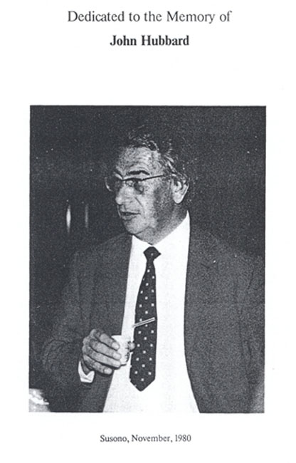

# 约翰·哈伯德

**英文名：** John Hubbard

**生卒：** 1931年10月27日 — 1980年11月27日

**主要领域：** 凝聚态理论、强关联电子、统计物理

约翰·哈伯德的历史本人照片，原图带有纪念标题及“Susono, November, 1980”说明；来自JINR研究人员所编传记，非同名数学家。

## 生平简介

英国理论物理学家，在伦敦帝国理工学院学习，后在哈韦尔原子能研究机构和美国IBM研究实验室工作。他以简化而保留关键电子相互作用的模型研究固体，推动强关联电子与多体量子理论的发展，英年早逝。

## 对物理的主要贡献

- 提出描述电子跃迁与局域相互作用的哈伯德模型
- 发展处理多体电子关联的理论方法与算符表述
- 研究电子气体、磁性及金属—绝缘体行为

## 肖像来源与许可

- 来源：[final-portrait-john-hubbard.jpg](https://theor.jinr.ru/~kuzemsky/hubbio2.html)
- 作者／署名：见原图页面
- 许可：Copyrighted institutional or historical photograph; no transferable open licence verified. Permission must be confirmed before website publication.
- 本地文件：[b6000d4602a2d406dbf3-8664b1409b.jpg](../portraits/b6000d4602a2d406dbf3-8664b1409b.jpg)
- 原始来源说明：A. L. Kuzemsky, Joint Institute for Nuclear Research; John Hubbard memorial photograph
- 授权状态：仅记录来源与本地档案副本；未确认可用于网站再发布，发布前须向权利人核实授权。

## 资料来源

- [JINR: Biography of John Hubbard](https://theor.jinr.ru/~kuzemsky/hubbio2.html)
- [Hubbard biography PDF hosted by JINR](https://theor.jinr.ru/~kuzemsky/Hubbard_John.pdf)
- [Wikipedia: John Hubbard (physicist)](https://en.wikipedia.org/wiki/John_Hubbard_%28physicist%29)

资料整理日期：2026-10-26。
