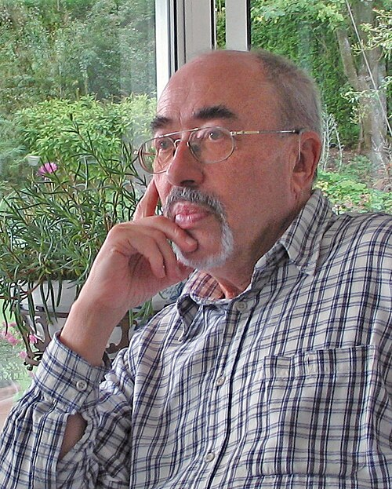

# 海因茨-迪特尔·策

**英文名：** H. Dieter Zeh

**生卒：** 1932年5月8日 — 2018年4月15日

**主要领域：** 量子基础、量子引力

肖像的作者、拍摄或创作年代及具体形式见图片来源。

## 生平简介

德国理论物理学家，长期在海德堡大学任教。他从核物理转向量子测量、时间箭头和宇宙学问题，强调环境对量子系统的影响，是退相干理论的重要开拓者。

## 对物理的主要贡献

- 提出通过环境相互作用解释量子退相干的框架
- 研究退相干与量子测量、经典世界出现之间的关系
- 讨论时间箭头与量子宇宙学

## 肖像来源与许可

- 来源：[DieterZeh2005-09-17-14-39-36.jpg](https://commons.wikimedia.org/wiki/File:DieterZeh2005-09-17-14-39-36.jpg)
- 作者／署名：Rolf Kickuth
- 许可：[CC BY-SA 3.0 de](https://en.wikipedia.org/wiki/en:Creative_Commons)
- 本地文件：[fa2e36ef87b27e7546bc.jpg](../portraits/fa2e36ef87b27e7546bc.jpg)
- 原始来源说明：Own work

## 资料来源

- [Wikipedia: H. Dieter Zeh](https://en.wikipedia.org/wiki/H._Dieter_Zeh)

资料整理日期：2026-10-26。
