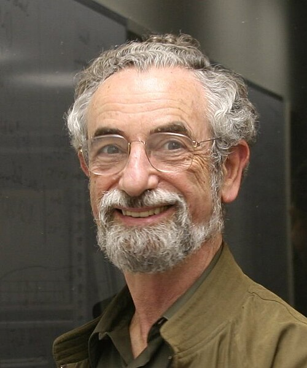

# 埃利奥特·利布

**英文名：** Elliott H. Lieb

**生卒：** 1932年7月31日 — 在世（截至资料整理日）

**主要领域：** 数学物理、量子多体

肖像的作者、拍摄或创作年代及具体形式见图片来源。

## 生平简介

美国数学物理学家，长期任教于普林斯顿大学。他以严格不等式和精确解研究物质稳定性、量子多体与统计力学，使基础物理问题获得严密数学表述。

## 对物理的主要贡献

- 研究物质稳定性及量子多体能量界
- 与罗宾逊建立量子格点传播速度界
- 求解重要统计模型并发展相关数学不等式

## 肖像来源与许可

- 来源：[Elliott-Lieb-07.jpeg](https://commons.wikimedia.org/wiki/File:Elliott-Lieb-07.jpeg)
- 作者／署名：Originally uploaded by Elieb (Transferred by Baroc)
- 许可：[CC BY-SA 3.0](https://creativecommons.org/licenses/by-sa/3.0)
- 本地文件：[cdc2f880d51cb82e3601-9e2d0f3cc0.jpeg](../portraits/cdc2f880d51cb82e3601-9e2d0f3cc0.jpeg)
- 原始来源说明：Originally uploaded on en.wikipedia

## 资料来源

- [Elliott H. Lieb — Wikipedia reference biography](https://en.wikipedia.org/wiki/Elliott_H._Lieb)
- [Elliott  Lieb](http://www.math.princeton.edu/~lieb/)
- [ICTP Dirac Medal — official laureate directory](https://www.ictp.it/prize/dirac-medal)

资料整理日期：2026-10-26。
