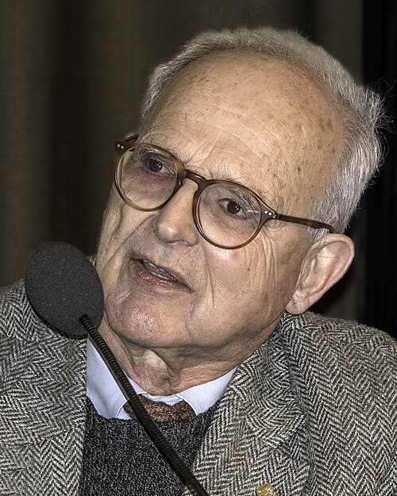

# 莱纳·魏斯

**英文名：** Rainer Weiss

**生卒：** 1932年9月29日 — 2025年8月25日

**主要领域：** 引力波、实验物理、相对论

肖像的作者、拍摄或创作年代及具体形式见图片来源。

## 生平简介

莱纳·魏斯出生于Berlin, Germany，主要从事引力波、实验物理、相对论研究。诺贝尔奖资料所列获奖时任职机构为LIGO/VIRGO Collaboration、Massachusetts Institute of Technology (MIT)。其代表成果包括对LIGO探测器及首次直接观测引力波作出关键贡献，获2017年诺贝尔物理学奖。

## 对物理的主要贡献

- 对LIGO探测器及首次直接观测引力波作出关键贡献
- 通过精密干涉测量开启引力波天文学

**诺贝尔物理学奖：** 2017

## 肖像来源与许可

- 来源：[Rainer_Weiss_EM1B8841_(24027015857).jpg](https://commons.wikimedia.org/wiki/File:Rainer_Weiss_EM1B8841_%2824027015857%29.jpg)
- 作者／署名：Bengt Nyman from Vaxholm, Sweden
- 许可：[CC BY 2.0](https://en.wikipedia.org/wiki/Flickr)
- 本地文件：[0a3db82b1ff008d76314.jpg](../portraits/0a3db82b1ff008d76314.jpg)
- 原始来源说明：Rainer Weiss EM1B8841

## 资料来源

- [Rainer Weiss - Facts](https://www.nobelprize.org/prizes/physics/2017/weiss/facts/)
- [Nobel Prize official laureate API, id 941](https://api.nobelprize.org/2.1/laureate/941)
- [Wikipedia: Rainer Weiss](https://en.wikipedia.org/wiki/Rainer_Weiss)

资料整理日期：2026-10-26。
