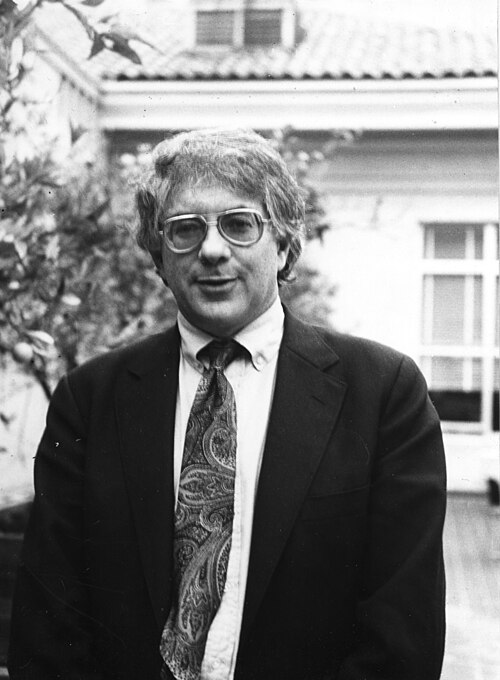

# 谢尔登·格拉肖

**英文名：** Sheldon Lee Glashow

**生卒：** 1932年12月5日 — 在世（截至资料整理日）

**主要领域：** 粒子物理、电弱理论

肖像的作者、拍摄或创作年代及具体形式见图片来源。

## 生平简介

谢尔登·格拉肖出生于New York, NY, USA，主要从事粒子物理、电弱理论研究。诺贝尔奖资料所列获奖时任职机构为Harvard University, Lyman Laboratory。其代表成果包括发展统一描述电磁相互作用和弱相互作用的理论，获1979年诺贝尔物理学奖。

## 对物理的主要贡献

- 发展统一描述电磁相互作用和弱相互作用的理论
- 预言和解释弱中性流等现象

**诺贝尔物理学奖：** 1979

## 肖像来源与许可

- 来源：[Sheldon_Glashow.jpg](https://commons.wikimedia.org/wiki/File:Sheldon_Glashow.jpg)
- 作者／署名：AIP Emilio Segrè Visual Archives, Segrè Collection
- 许可：Attribution
- 本地文件：[9d6a419dcf5f10ec1bc9.jpg](../portraits/9d6a419dcf5f10ec1bc9.jpg)
- 原始来源说明：https://repository.aip.org/informal-portrait-glashow-1

## 资料来源

- [Sheldon Glashow - Facts](https://www.nobelprize.org/prizes/physics/1979/glashow/facts/)
- [Nobel Prize official laureate API, id 113](https://api.nobelprize.org/2.1/laureate/113)
- [Wikipedia: Sheldon Lee Glashow](https://en.wikipedia.org/wiki/Sheldon_Lee_Glashow)

资料整理日期：2026-10-26。
