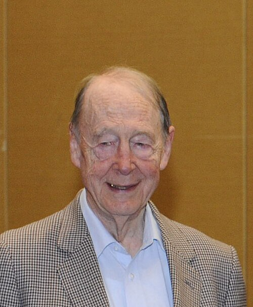

# 汤姆·基布尔

**英文名：** Tom Kibble

**生卒：** 1932年12月23日 — 2016年6月2日

**主要领域：** 粒子物理、宇宙学

肖像的作者、拍摄或创作年代及具体形式见图片来源。

## 生平简介

出生于印度马德拉斯的英国理论物理学家，长期在伦敦帝国理工学院工作。他对自发对称性破缺及规范场质量机制的研究，连接了粒子物理、相变和早期宇宙缺陷问题。

## 对物理的主要贡献

- 与古拉尔尼克、哈根独立提出规范理论中的对称性破缺机制
- 提出相变产生拓扑缺陷的基布尔机制
- 推动基布尔—祖雷克非平衡相变理论

## 肖像来源与许可

- 来源：[Kibble_at_AIP-Sakurai.jpg](https://commons.wikimedia.org/wiki/File:Kibble_at_AIP-Sakurai.jpg)
- 作者／署名：Jason Socrates Bardi
- 许可：Public domain
- 本地文件：[27edf906e95f63c1ada3.jpg](../portraits/27edf906e95f63c1ada3.jpg)
- 原始来源说明：Own work

## 资料来源

- [CERN：Tom Kibble (1932–2016)](https://home.cern/tom-kibble-1932-2016/)
- [Wikipedia: Tom Kibble](https://en.wikipedia.org/wiki/Tom_Kibble)

资料整理日期：2026-10-26。
