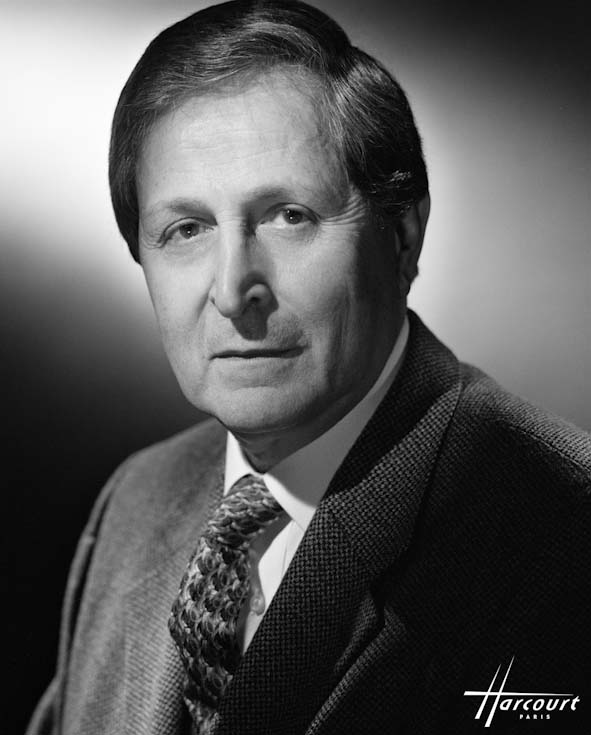

# 克洛德·科恩-塔诺季

**英文名：** Claude Cohen-Tannoudji

**生卒：** 1933年4月1日 — 2026年10月22日

**主要领域：** 原子物理、激光冷却

肖像的作者、拍摄或创作年代及具体形式见图片来源。

## 生平简介

克洛德·科恩-塔诺季出生于Constantine, French Algeria (now Algeria)，主要从事原子物理、激光冷却研究。诺贝尔奖资料所列获奖时任职机构为Collège de France、École Normale Supérieure。其代表成果包括发展利用激光冷却和俘获原子的方法，获1997年诺贝尔物理学奖。

## 对物理的主要贡献

- 发展利用激光冷却和俘获原子的方法
- 为超冷原子、精密测量和量子气体实验提供基础

**诺贝尔物理学奖：** 1997

## 史料说明

- 截至2026年10月26日，诺贝尔结构化资料尚未列出逝世日期。已据卡斯特勒-布罗塞尔实验室及法国国家图书馆2026年10月23日的公告核实：于10月22日逝世，不能将公告发布日期当作逝世日。

## 肖像来源与许可

- 来源：[COHEN TANNOUDJI Claude-24x30-1999.jpg](https://commons.wikimedia.org/wiki/File:COHEN_TANNOUDJI_Claude-24x30-1999.jpg)
- 作者／署名：Studio Harcourt
- 许可：[CC BY 3.0](https://creativecommons.org/licenses/by/3.0)
- 本地文件：[1c6b125c2ce8c4f30af5.jpg](../portraits/1c6b125c2ce8c4f30af5.jpg)
- 原始来源说明：Studio Harcourt Paris (http://studio-harcourt.eu/)

## 资料来源

- [Claude Cohen-Tannoudji - Facts](https://www.nobelprize.org/prizes/physics/1997/cohen-tannoudji/facts/)
- [Nobel Prize official laureate API, id 153](https://api.nobelprize.org/2.1/laureate/153)
- [Wikipedia: Claude Cohen-Tannoudji](https://en.wikipedia.org/wiki/Claude_Cohen-Tannoudji)
- [Laboratoire Kastler Brossel: Claude Cohen-Tannoudji has passed away (23 October 2026)](https://www.lkb.fr/en/death-of-claude-cohen-tannoudji/)
- [Bibliothèque nationale de France: Death of physicist Claude Cohen-Tannoudji](https://www.bnf.fr/fr/actualites/deces-du-physicien-claude-cohen-tannoudji)

资料整理日期：2026-10-26。
