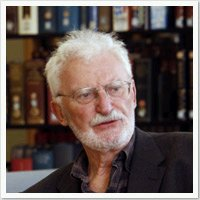

# 海因里希·罗雷尔

**英文名：** Heinrich Rohrer

**生卒：** 1933年6月6日 — 2013年5月16日

**主要领域：** 表面物理、扫描探针

肖像的作者、拍摄或创作年代及具体形式见图片来源。

## 生平简介

海因里希·罗雷尔出生于Buchs, Switzerland，主要从事表面物理、扫描探针研究。诺贝尔奖资料所列获奖时任职机构为IBM Zurich Research Laboratory。其代表成果包括与格尔德·宾尼希共同发展扫描隧道显微镜，获1986年诺贝尔物理学奖。

## 对物理的主要贡献

- 与格尔德·宾尼希共同发展扫描隧道显微镜
- 开创可在原子尺度研究表面结构的扫描探针方法

**诺贝尔物理学奖：** 1986

## 肖像来源与许可

- 来源：[Rohrer.jpg](https://commons.wikimedia.org/wiki/File:Rohrer.jpg)
- 作者／署名：NIMSoffice
- 许可：[CC BY-SA 3.0](https://en.wikipedia.org/wiki/en:GNU_Free_Documentation_License)
- 本地文件：[ba13a74026b0e6a579e3.jpg](../portraits/ba13a74026b0e6a579e3.jpg)
- 原始来源说明：Own work

## 资料来源

- [Heinrich Rohrer - Facts](https://www.nobelprize.org/prizes/physics/1986/rohrer/facts/)
- [Nobel Prize official laureate API, id 129](https://api.nobelprize.org/2.1/laureate/129)
- [Wikipedia: Heinrich Rohrer](https://en.wikipedia.org/wiki/Heinrich_Rohrer)

资料整理日期：2026-10-26。
