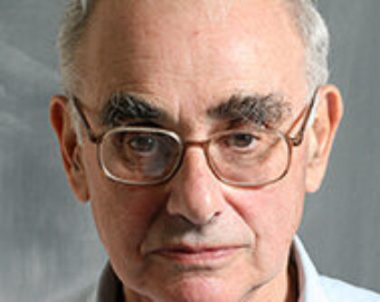

# 杰弗里·戈德斯通

**英文名：** Jeffrey Goldstone

**生卒：** 1933年9月3日 — 2026年10月12日

**主要领域：** 量子场论、量子多体

肖像的作者、拍摄或创作年代及具体形式见图片来源。

## 生平简介

英国理论物理学家，曾在剑桥工作，后长期任教于麻省理工学院。他研究多费米子体系、自发对称性破缺和量子计算，2026年10月逝世。

## 对物理的主要贡献

- 建立连续对称性自发破缺产生无质量模的戈德斯通定理
- 发展多费米子体系的图形计算方法
- 研究量子计算和量子算法

## 肖像来源与许可

- 来源：[modern-extra-jeffrey-goldstone.jpg](https://physics.mit.edu/faculty/jeffrey-goldstone/)
- 作者／署名：见原图页面
- 许可：Copyrighted image; no transferable open licence verified. Permission must be confirmed before website publication.
- 本地文件：[97d63b216a377ac5ed7a-2de4410142.jpg](../portraits/97d63b216a377ac5ed7a-2de4410142.jpg)
- 原始来源说明：MIT Department of Physics faculty portrait
- 授权状态：仅记录来源与本地档案副本；未确认可用于网站再发布，发布前须向权利人核实授权。

## 资料来源

- [Jeffrey Goldstone — MIT Physics, in memoriam1933–2026](https://physics.mit.edu/faculty/jeffrey-goldstone/)
- [Jeffrey Goldstone — Wikipedia reference biography](https://en.wikipedia.org/wiki/Jeffrey_Goldstone)
- [Dirac Medallists 1991 | ICTP](https://www.ictp.it/home/dirac-medallists-1991)
- [ICTP Dirac Medal — official laureate directory](https://www.ictp.it/prize/dirac-medal)

资料整理日期：2026-10-26。
